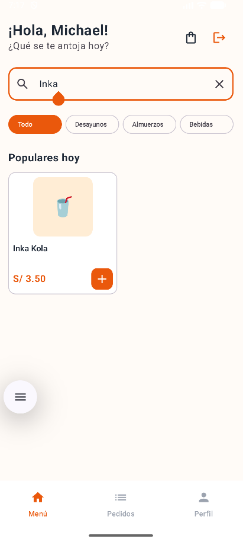
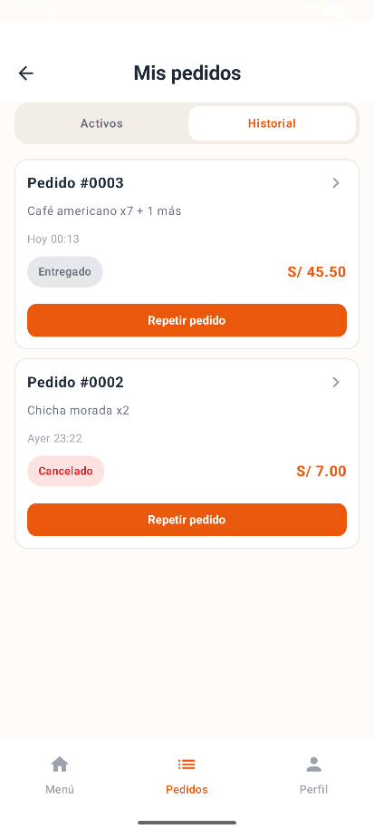
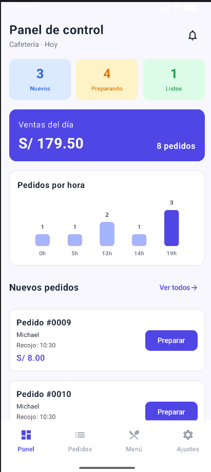

# CafeCampus — Fase 2: mejoras con IA

**Proyecto:** CafeCampus  
**Tecnologías:** Kotlin, Jetpack Compose, Material 3, Room, MVVM y Repository  
**Herramienta de IA:** Gemini en Android Studio  
**Rama:** `con-ia`

## Objetivo

Implementar tres mejoras funcionales con apoyo de IA, sin alterar las funcionalidades de la Fase 1 y respetando la arquitectura `View → ViewModel → CafeRepository → CafeRepositoryRoom → DAO → Room`.

> **Sobre los prompts:** Los textos de las secciones siguientes documentan las instrucciones empleadas para cada mejora. Algunas formulaciones se han reconstruido a partir del trabajo realizado en la conversación; antes de entregar, cotejarlas con el historial de Gemini para cumplir estrictamente el requisito de incluir los **prompts literales**.

## Mejora A — Búsqueda de productos en el menú

**Commit:** `5310994` — `ia: agrega busqueda de productos en el menu`

### Prompt documentado (verificar texto literal en Gemini)

> Analiza la estructura de CafeCampus y agrega una búsqueda de productos por nombre en la pantalla del menú del estudiante. La búsqueda debe filtrar mientras se escribe, sin distinguir mayúsculas de minúsculas, y funcionar junto con el filtro de categorías. Conserva el carrito, el diseño y la navegación existentes. Coloca la lógica de filtrado en `MenuViewModel` utilizando `StateFlow`, y deja en `MenuScreen` solamente la interfaz y sus eventos. Respeta MVVM y Repository. No realices commits automáticamente.

### Cambios realizados

- `MenuViewModel.kt`: estado de búsqueda, categoría seleccionada y filtrado reactivo mediante `combine` y `StateFlow`.
- `MenuScreen.kt`: campo de búsqueda conectado al ViewModel y filtros funcionales.
- La búsqueda se combina con la categoría seleccionada y no exige consultas al DAO desde la pantalla.

**Comprobación:** El menú filtra los productos mientras se escribe y conserva las funciones del carrito.

## Mejora B — Repetir pedido desde el historial

**Commit:** `bbc0d0e` — `ia: agrega repetir pedido desde el historial`

### Prompt documentado (verificar texto literal en Gemini)

> Tengo una aplicación Android llamada CafeCampus, desarrollada en Kotlin, Jetpack Compose, Material 3, MVVM, Repository y Room. Estoy trabajando en la rama `con-ia` para implementar la Mejora B: repetir pedido desde el historial. Analiza `MenuViewModel.kt`, `MisPedidosScreen.kt`, `NavCafe.kt`, `PedidoConDetalle.kt` y `DetallePedido.kt`. Agrega un botón «Repetir pedido» en el historial, conectado mediante un callback. Recupera los productos y cantidades del pedido anterior, verifica que sigan existiendo y estén disponibles, utiliza sus precios actuales y omite los no disponibles informando al estudiante. Si ya hay un producto en el carrito, suma cantidades en vez de duplicar líneas. No confirmes automáticamente otro pedido: primero debe poder revisarse el carrito. Mantén búsqueda, filtros, navegación e historial; no modifiques las tablas Room. Respeta MVVM + Repository y no realices commits automáticamente.

### Cambios realizados

- `MisPedidosScreen.kt`: acción «Repetir pedido» en el historial.
- `MenuViewModel.kt`: lógica de incorporación de productos y cantidades al carrito.
- `NavCafe.kt`: conexión de la acción y navegación para revisar el pedido.

**Comprobación:** Se pueden volver a agregar productos de pedidos anteriores sin confirmar automáticamente una compra nueva.

## Mejora C — Gráfico real de pedidos por hora

**Commit:** `8b645b0` — `ia: agrega grafico real de pedidos por hora`

### Prompt documentado (verificar texto literal en Gemini)

> Estoy trabajando en CafeCampus, una aplicación Android desarrollada en Kotlin, Jetpack Compose, Material 3, MVVM, Repository y Room. Necesito implementar la Mejora C de la Fase 2: un gráfico real de pedidos por hora en el Panel del administrador. Revisa `PedidoDao.kt`, `CafeRepository.kt`, `CafeRepositoryRoom.kt`, `PanelAdminViewModel.kt`, `PanelScreen.kt` y `NavCafe.kt`. Reemplaza las barras con valores fijos por cantidades obtenidas desde Room, agrupando pedidos por hora y filtrando únicamente el día actual según la hora local del dispositivo. La columna `fecha` almacena milisegundos. Usa consultas `Flow`, publica los datos desde `StateFlow` y muestra un estado vacío cuando no haya pedidos. Conserva los contadores, las ventas y el resto de funciones. No modifiques el esquema de las tablas ni agregues bibliotecas de gráficos innecesarias. Respeta MVVM + Repository. No realices commits automáticamente.

### Cambios realizados

- `PedidoDao.kt`: consulta SQL de pedidos agrupados por hora.
- `PedidosPorHora.kt`: modelo para hora y cantidad.
- `CafeRepository.kt` y `CafeRepositoryRoom.kt`: operación para observar las cantidades.
- `PanelAdminViewModel.kt`: estado reactivo del gráfico y cálculo del intervalo del día.
- `PanelScreen.kt` y `NavCafe.kt`: representación del gráfico y conexión con el ViewModel.

### Corrección y aprendizaje

El gráfico agrupaba pedidos a las **19h** cuando en Perú eran las **14h**. Se revisó la conversión horaria y se detectó que la **zona horaria del emulador** no correspondía a Lima. Al configurarla en **Perú (UTC−5)**, se corrigió la visualización. Esto mostró la importancia de probar el código generado por IA en el dispositivo real de ejecución.

**Comprobación:** Las barras aumentan al registrar pedidos y se agrupan por la hora local configurada en el emulador.

## Evaluación del uso de IA y de la arquitectura

Gemini ayudó a implementar las tres mejoras, pero las modificaciones se revisaron antes de registrarlas en Git. Las pantallas Compose presentan información y reciben eventos; los ViewModels administran estados y lógica de interfaz; la interfaz `CafeRepository` abstrae el origen de datos, y Room ejecuta la persistencia a través de los DAO. La incidencia de la zona horaria mostró que compilar no sustituye a probar el funcionamiento.

## Reflexión personal (cinco líneas)

1. Gemini me ayudó a desarrollar funciones que mejoraron el uso de CafeCampus.
2. Aprendí a revisar sus respuestas porque el código generado puede necesitar correcciones.
3. La arquitectura MVVM permitió separar las pantallas de la lógica del sistema.
4. Con Room pude mostrar datos reales de los pedidos en el panel del administrador.
5. Las pruebas me ayudaron a detectar el error de la zona horaria y solucionarlo.

## Evidencias y commits

| Mejora | Commit | Evidencia                  |
|---|---|----------------------------|
| A — Búsqueda de productos | `5310994` | `capturas/ia-commit-A.png` |
| B — Repetir pedido | `bbc0d0e` | `capturas/ia-commit-B.png` |
| C — Pedidos por hora | `8b645b0` | `capturas/ia-commit-C.png` |

**Nota:** Las capturas deben guardarse físicamente dentro de la carpeta `capturas` del proyecto, con exactamente los nombres indicados. Los enlaces Markdown no incorporan las imágenes por sí solos.
