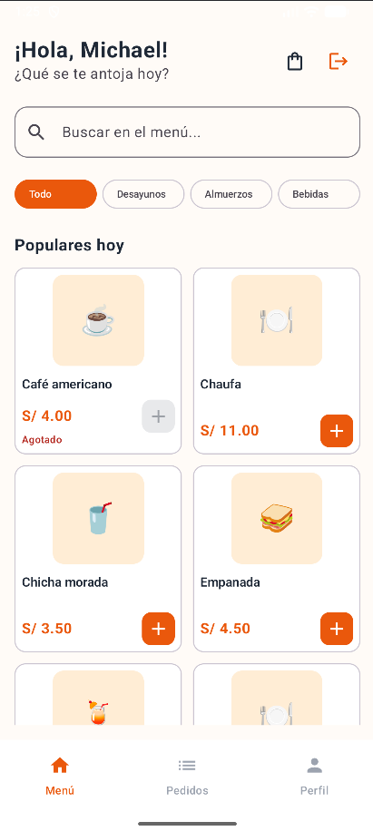
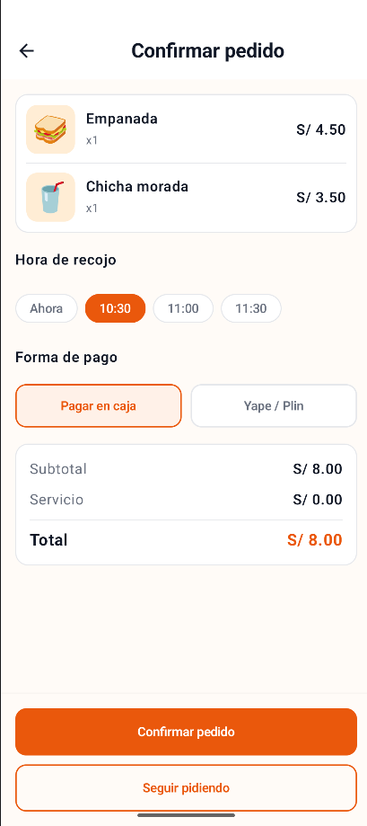
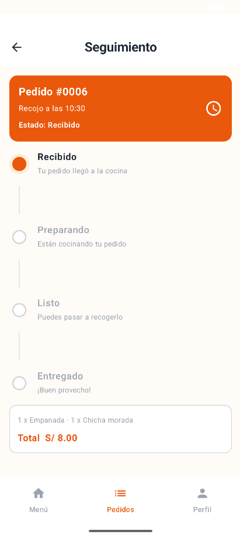
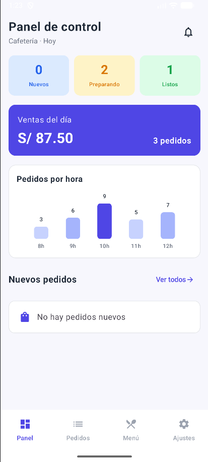
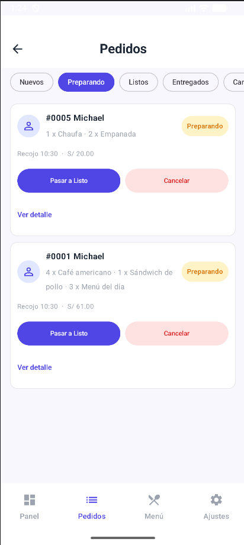
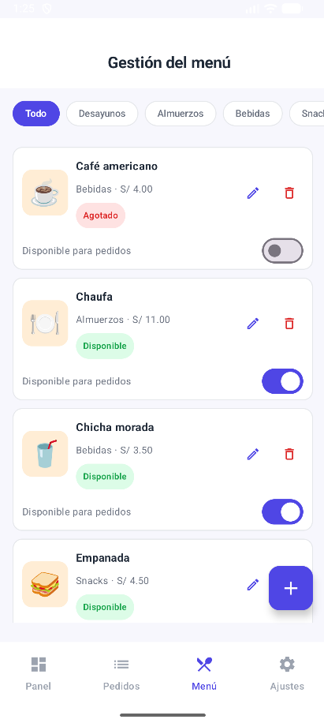

# CafeCampus

Aplicación Android para gestionar pedidos de una cafetería de campus. El estudiante consulta productos, arma su carrito, realiza pedidos y sigue su estado. El administrador gestiona pedidos, productos y preferencias del servicio. Ambos perfiles comparten una base de datos local Room.

## Tecnologías utilizadas

- **Kotlin** como lenguaje principal.
- **Jetpack Compose y Material 3** para la interfaz.
- **MVVM** para separar interfaz y lógica de presentación.
- **Repository (interfaz)** para abstraer el acceso a datos.
- **Room** para usuarios, productos, pedidos y detalles.
- **DataStore Preferences** para perfil activo, sesión y ajustes.
- **Navigation Compose** para navegar entre pantallas.
- **Coroutines, Flow y StateFlow** para operaciones asíncronas y estados observables.

## Funcionalidades

### Estudiante

- Inicio de sesión y pantalla de perfil.
- Menú con categorías, detalle del producto y carrito.
- Confirmación de pedidos con hora de recojo y forma de pago.
- Seguimiento en tiempo real del estado de pedidos almacenados en Room e historial.
- Restricción de productos agotados y bloqueo de confirmación cuando la cafetería no recibe pedidos.
- Cierre de sesión.

### Administrador

- Panel con contadores de pedidos y ventas del día.
- Gestión del estado de pedidos: Recibido, Preparando, Listo, Entregado y Cancelado.
- Consulta del detalle de cada pedido.
- Alta, edición, eliminación y control de disponibilidad de productos.
- Filtros de productos por categoría.
- Ajustes de modo oscuro, notificaciones y recepción de pedidos.
- Cambio directo al perfil de estudiante y cierre de sesión.

> La opción «Notificaciones» guarda una preferencia; no implementa notificaciones reales del sistema Android. El gráfico de pedidos por hora, si se muestra, todavía utiliza datos ilustrativos; el gráfico alimentado por Room corresponde a una mejora propuesta para la Fase 2.

## Arquitectura MVVM

```text
Pantallas (Jetpack Compose)
          │ eventos / StateFlow
          ▼
       ViewModels
          │ operaciones / Flow
          ▼
CafeRepository (interfaz)
          ▲ implementa
          │
 CafeRepositoryRoom
          │
          ▼
      Room / DAO
          │
          ▼
   SQLite local

DataStore Preferences ──► ViewModel de sesión
```

Las pantallas no acceden directamente a los DAOs. Los ViewModels usan el contrato `CafeRepository`, y las lecturas reactivas se exponen mediante `Flow`/`StateFlow`.

## Estructura de paquetes

```text
app/src/main/java/com/fernandez/cafecampus/
├── MainActivity.kt
├── CafeApp.kt
├── data/
│   ├── local/
│   │   ├── entity/       # Usuario, Producto, Pedido, DetallePedido
│   │   ├── dao/          # Consultas Room
│   │   ├── relation/     # PedidoConDetalle
│   │   ├── CafeDatabase.kt
│   │   └── DatosIniciales.kt
│   ├── repository/       # CafeRepository y CafeRepositoryRoom
│   └── prefs/            # PreferenciasStore
├── model/                # Rol, EstadoPedido, ItemCarrito
├── viewmodel/            # Sesión, menú, pedidos y administración
└── ui/
    ├── theme/
    ├── components/
    ├── navigation/       # Rutas y NavCafe
    ├── cliente/          # Login, menú, carrito, pedidos y perfil
    └── admin/            # Panel, pedidos, productos y ajustes
```

## Credenciales de prueba

| Perfil | Correo | Contraseña |
| --- | --- | --- |
| Estudiante | `michael@campus.test` | `1234` |
| Administrador | `admin@cafe.test` | `admin` |

> Cuentas ficticias para el laboratorio local; no son credenciales apropiadas para producción.

## Requisitos y ejecución

1. Abre la carpeta `Semana08/CafeCampus` en Android Studio.
2. Espera la sincronización de Gradle.
3. Selecciona un emulador o dispositivo Android compatible.
4. Ejecuta el módulo `app`.

Para compilar desde PowerShell:

```powershell
.\gradlew.bat :app:assembleDebug
```

## Pruebas de aceptación — Fase 1

Resultados reportados tras las pruebas manuales en el emulador:

| Prueba | Resultado esperado | Estado |
| --- | --- | --- |
| Login con clave incorrecta | Muestra un error y no permite ingresar | OK |
| Agregar dos productos y confirmar | Pedido `RECIBIDO` con total correcto | OK |
| Producto agotado | No se puede agregar al pedido | OK |
| Pasar pedido a Preparando | El seguimiento refleja `PREPARANDO` sin reiniciar | OK |
| Cancelar pedido | Aparece como `CANCELADO` en el historial | OK |
| Cambiar precio de un producto | Los pedidos antiguos mantienen su precio | OK |
| Ventas del día | Excluye pedidos cancelados | OK |
| Cerrar y abrir la aplicación | Conserva pedidos y perfil activo | OK |
| Rotar el dispositivo | No se pierde el carrito ni los datos | OK |

**Pruebas adicionales realizadas:** acceso a Ajustes y Perfil del estudiante, bloqueo de nuevos pedidos al desactivar «Recibir pedidos», y cambio directo de Administrador a Estudiante. Conviene adjuntar capturas de evidencia.

## Capturas de pantalla

La guía solicita **6 capturas: 3 del estudiante y 3 del administrador**. Guarda las imágenes en `capturas/` con los siguientes nombres para que los enlaces funcionen:

### Estudiante

**1. Menú de productos**



**2. Confirmar pedido**



**3. Seguimiento del pedido**



### Administrador

**4. Panel de control**



**5. Gestión de pedidos**



**6. Gestión del menú**




## Para pensar

**¿Por qué el Repository es una interfaz?** Permite cambiar la fuente de datos sin modificar los ViewModels.

**¿Por qué `crearPedido` es `suspend` y `observarPedidosCliente` es `Flow`?** `crearPedido` realiza una escritura puntual; `Flow` observa cambios continuos.

**¿Qué pasaría si los dos perfiles utilizaran bases de datos distintas?** Los cambios del administrador no se reflejarían automáticamente en los pedidos del estudiante.

**¿Qué debería cambiar si los datos pasaran a un servidor?** Se implementaría otra versión del Repository conectada a una API, manteniendo su contrato.

## Alcance

Proyecto académico de práctica de Kotlin, Compose, MVVM, Repository, Room y DataStore. Los datos se guardan localmente; no hay backend remoto ni procesamiento real de pagos.
