# MuroCampus

Laboratorio 09 — Programación en Móviles.

## 1. Descripción del proyecto

MuroCampus es una aplicación Android desarrollada con Kotlin, Jetpack Compose y Material 3. Consume los servicios REST de [JSONPlaceholder](https://jsonplaceholder.typicode.com/) para listar publicaciones, consultar su detalle y comentarios, filtrar por usuario y enviar una publicación de prueba.

La interfaz representa la carga, el éxito y los errores sin bloquear el hilo principal. La implementación base utiliza MVVM + Repository.

## 2. Objetivos

- Consumir servicios REST con Retrofit y OkHttp.
- Convertir JSON a modelos Kotlin mediante kotlinx.serialization.
- Ejecutar operaciones suspendidas con corrutinas y exponer sus estados con StateFlow.
- Separar presentación, estado y acceso a datos mediante MVVM + Repository.
- Manejar errores de conexión, HTTP y serialización con mensajes comprensibles.
- Aplicar GET y POST, parámetros de ruta con `@Path`, consultas con `@Query` y cuerpos con `@Body`.
- Verificar el funcionamiento con pruebas unitarias, instrumentadas y solicitudes reales.

## 3. Tecnologías utilizadas

Versiones declaradas en Gradle y en el catálogo del proyecto:

| Tecnología o configuración | Versión / valor |
|---|---|
| Android Gradle Plugin | 9.2.1 |
| Gradle Wrapper | 9.4.1 |
| Kotlin / plugins Compose y Serialization | 2.2.10 |
| Jetpack Compose y Material 3 | BOM 2026.02.01 |
| AndroidX Core KTX | 1.19.1 |
| Activity Compose | 1.13.0 |
| Lifecycle | 2.11.0 |
| Coroutines Android y Test | 1.9.0 |
| Retrofit y converter Kotlinx Serialization | 2.11.0 |
| Kotlinx Serialization JSON | 1.7.3 |
| OkHttp y Logging Interceptor | 4.12.0 |
| JUnit | 4.13.2 |
| AndroidX Test JUnit / Espresso | 1.3.0 / 3.7.0 |
| JDK del daemon Gradle | 21 |
| Compatibilidad Java del módulo | 11 |
| compileSdk / targetSdk / minSdk | 37 / 36 / 24 |
| BuildConfig | Habilitado |

El registro HTTP de OkHttp utiliza nivel BODY en debug y NONE en release. No se agregaron dependencias para la creación ni para la documentación final.

## 4. Arquitectura MVVM + Repository

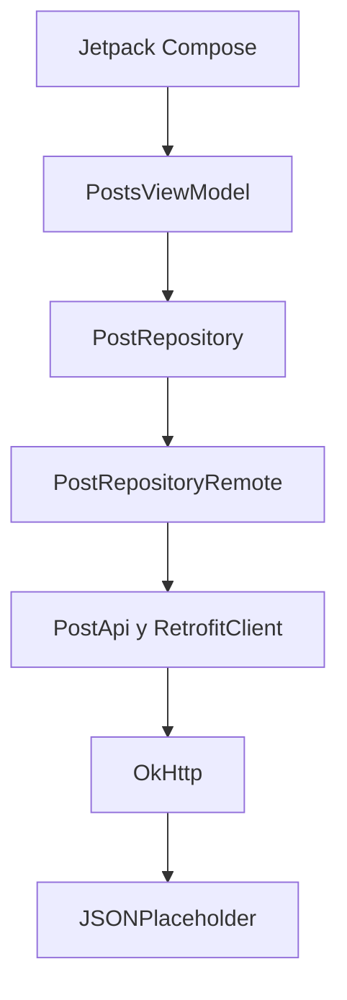

- **Compose:** muestra los estados y comunica las acciones del usuario. Las pantallas observan los flujos con `collectAsStateWithLifecycle`.
- **PostsViewModel:** mantiene los estados independientes de lista, detalle y creación. Coordina corrutinas, filtro y cancelación; no conoce Retrofit ni utiliza Context.
- **PostRepository:** define operaciones suspendidas que devuelven `Result`.
- **PostRepositoryRemote:** delega en la API y transforma las excepciones ordinarias en fallos. Relanza `CancellationException`.
- **PostApi y RetrofitClient:** describen los endpoints y configuran URL base, cliente HTTP y conversor JSON.
- **MainActivity:** es el punto de composición de dependencias y navegación. Obtiene el ViewModel con `ViewModelProvider` y su factory; no ejecuta HTTP directamente.
- **MensajesError.kt:** transforma excepciones técnicas en mensajes de conexión, servidor, respuesta inesperada o error desconocido.

El flujo de datos vuelve a la interfaz mediante StateFlow. Cada operación mantiene un Job independiente para no cancelar, por ejemplo, la lista al cerrar el detalle o el formulario.

## 5. Estructura de paquetes

Código de producción en `app/src/main/java/`:

```text
com.fernandez.murocampus/
├── MainActivity.kt
├── model/
│   └── Modelos.kt
├── data/
│   ├── MensajesError.kt
│   ├── PostRepository.kt
│   └── remote/
│       ├── PostApi.kt
│       └── RetrofitClient.kt
├── viewmodel/
│   ├── UiState.kt
│   ├── PostsViewModel.kt
│   └── PostsViewModelFactory.kt
└── ui/
    ├── Componentes.kt
    ├── PantallaLista.kt
    ├── PantallaDetalle.kt
    ├── PantallaCrear.kt
    └── theme/
        ├── Color.kt
        ├── Theme.kt
        └── Type.kt
```

`Modelos.kt` contiene `Post`, `Comentario`, `NuevoPost` y `Usuario`. `UiState` representa Cargando, Exito y Error. `DetalleUi`, declarado en el archivo del ViewModel, reúne una publicación y sus comentarios. La creación utiliza `UiState<Post>?`: `null` significa que aún no se ha enviado el formulario.

`Componentes.kt` reúne la tarjeta de publicación, el indicador de carga y el error con reintento. Cada pantalla se ocupa de representar su estado. Las pruebas JVM están en `app/src/test/` y las pruebas Compose en `app/src/androidTest/`.

## 6. Servicio web REST

URL base: `https://jsonplaceholder.typicode.com/`.

Estas operaciones no requieren token de API.

| Método | Ruta relativa | Entrada | Respuesta Kotlin |
|---|---|---|---|
| GET | `posts` | Sin parámetros | `List<Post>` |
| GET | `posts/{id}` | `@Path("id") id: Int` | `Post` |
| GET | `posts/{id}/comments` | `@Path("id") id: Int` | `List<Comentario>` |
| GET | `posts?userId=2` | Ejemplo de `@Query("userId") userId: Int` | `List<Post>` |
| POST | `posts` | `@Body nuevo: NuevoPost` | `Post` |

`@GET` obtiene recursos y `@POST` envía datos de creación. `@Path` sustituye una parte de la ruta; `@Query` incorpora parámetros en la URL; `@Body` serializa un objeto dentro del cuerpo HTTP.

Ejemplo del cuerpo enviado por el formulario, con `Content-Type: application/json; charset=utf-8`:

```json
{
  "userId": 1,
  "title": "Mi primera publicación",
  "body": "Hola desde MuroCampus"
}
```

`NuevoPost` no incluye identificador. El identificador de la confirmación se obtiene del `Post` recibido, no de un valor fijo escrito en la interfaz.

## 7. Funcionalidades implementadas

- **Lista:** carga remota de publicaciones en una LazyColumn con claves por ID, título en negrita y cuerpo limitado a dos líneas.
- **Estados:** Cargando, Exito y Error mediante `when` sobre UiState. Una lista vacía válida muestra «Sin publicaciones».
- **Reintentar:** vuelve a consultar respetando el filtro activo.
- **Detalle:** solicita la publicación seleccionada y sus comentarios con `@Path`, mostrando el texto completo y `Comentarios (N)` según la respuesta.
- **Filtro:** once chips en una LazyRow: Todos y Usuario 1–10. Consulta `porUsuario(userId)` de forma remota; no sustituye la consulta por un filtrado local.
- **Creación:** FAB accesible en la lista, formulario con Título y Contenido, botón Publicar y confirmación verde con el ID recibido.
- **Validación:** campos vacíos o compuestos solo por espacios no permiten enviar. El ViewModel vuelve a validarlos y recorta sus extremos.
- **Errores de creación:** conserva los campos y permite volver a pulsar Publicar. No hay reintentos automáticos de POST.
- **Navegación:** una Activity, selección guardable y BackHandler. Al volver no se descarga la lista innecesariamente; se conservan filtro y desplazamiento.
- **Rotación:** conserva pantalla, selección, formulario y estado del ViewModel durante la recreación comprobada, sin repetir automáticamente solicitudes.
- **Concurrencia:** evita envíos simultáneos duplicados y cancela o invalida resultados obsoletos con trabajos y versiones independientes.

Atrás permite salir del formulario y cancela el trabajo local pendiente. **Cancelar la corrutina no revierte un POST que ya llegó al servidor.** Si un envío falla, no debe asumirse que el servidor nunca lo recibió; el usuario decide si vuelve a publicar.

## 8. Instrucciones de ejecución

```bash
git clone https://github.com/mfernandezc-dev/Moviles_Fernandez.git
```

Abrir este proyecto, no los otros laboratorios del repositorio:

```text
Moviles_Fernandez/Semana09/MuroCampus
```

1. Abrir la carpeta MuroCampus en Android Studio compatible con AGP 9.2.1.
2. Configurar un JDK 21 compatible para Gradle; el proyecto declara esa versión en `gradle/gradle-daemon-jvm.properties`.
3. Instalar Android SDK Platform 37 y las herramientas solicitadas por Android Studio.
4. Sincronizar Gradle y permitir la descarga inicial de dependencias.
5. Seleccionar un dispositivo o emulador con Android API 24 o superior. Las verificaciones de este laboratorio utilizaron Medium_Phone, API 37.
6. Ejecutar la aplicación y comprobar la conexión a internet.

`local.properties` configura localmente la ruta del SDK y no está publicado. No es necesario copiar rutas privadas de otra computadora ni configurar un token de JSONPlaceholder.

Desde la carpeta del proyecto, en PowerShell:

```powershell
.\gradlew.bat :app:assembleDebug
.\gradlew.bat :app:testDebugUnitTest
.\gradlew.bat :app:lintDebug
```

Con un dispositivo conectado y reconocido por ADB:

```powershell
.\gradlew.bat :app:connectedDebugAndroidTest
```

Con las dependencias ya disponibles en caché, también se verificaron las unitarias sin acceso a repositorios remotos:

```powershell
.\gradlew.bat :app:testDebugUnitTest --offline --rerun-tasks
```

Si HTTPS falla después de restaurar un snapshot, comprobar fecha y hora del emulador. No desactivar la validación TLS ni aceptar certificados indiscriminadamente.

## 9. Pruebas realizadas

Resultados de la implementación definitiva del Commit 10, comprobados nuevamente durante el cierre de documentación. Las ejecuciones repetidas no cuentan como pruebas diferentes.

| Verificación | Resultado | Tipo de evidencia |
|---|---|---|
| Compilación debug | BUILD SUCCESSFUL | Gradle |
| Pruebas unitarias | **163 aprobadas** | JVM, Repository falso y comprobaciones de contrato |
| Pruebas instrumentadas | **40 aprobadas** | Compose con respuestas controladas |
| Fallos / errores / omitidas | **0 / 0 / 0** | Reportes XML de ambas suites |
| Total de pruebas diferentes | **203** | 163 + 40 |
| Lint | **24 advertencias y 0 errores** | Reporte de lint, sin aumento frente al Commit 9 |
| GET de lista | HTTP 200 y 100 publicaciones | Aplicación real y Logcat |
| Detalle y comentarios de publicación 1 | HTTP 200 en ambas consultas; cinco comentarios | Aplicación real, Logcat e interfaz |
| Usuario 1–10 | HTTP 200; diez publicaciones por usuario, todos los `userId` correctos | Comprobación real del Commit 9, conservada como evidencia |
| Regresión de Todos y Usuario 2 | 100 y diez publicaciones respectivamente | APK definitiva del Commit 10 |
| POST del formulario | **HTTP 201**, ID **101**, título y contenido coincidentes | Solicitud y respuesta reales de MuroCampus |
| Error sin internet | Error visible en lista y creación | Conexión desactivada solo en el emulador |
| Recuperación | Reintentar en lista y nuevo intento voluntario en creación correctos | Aplicación real; creación volvió a recibir HTTP 201 |
| Conservación de campos | Título y contenido intactos tras el error | Interfaz real y pruebas Compose |
| Rotación del formulario | Conserva borrador y confirmación; POST 0→0 y 1→1 | Recreación real de Activity y Logcat |
| Regreso desde creación | Usuario 2 y desplazamiento conservados; GET 2→2 | Aplicación real |
| HTTP 404 y 500, serialización y cancelación | Casos aprobados | Pruebas controladas; no se presentan como fallos HTTP reales del proveedor |

Las 132 unitarias y 25 instrumentadas anteriores se conservaron. La creación añadió 31 unitarias y 15 instrumentadas.

Los estados pendientes de carga y publicación, las listas vacías y las respuestas tardías se verificaron de forma determinista con Repository falsos. La evidencia de Cargando no se presenta como una captura de una solicitud real en curso. Las cinco imágenes siguientes sí proceden de interacciones reales con la API, salvo el error real provocado al desconectar el emulador.

No se verificó persistencia ante muerte del proceso. La conservación de estado documentada corresponde a rotación y restauración de estado comprobadas. Las advertencias de lint incluyen versiones más recientes disponibles y recursos existentes sin uso; no se ocultaron mediante desactivación de verificaciones.

## 10. Evidencias de funcionamiento

Las cinco capturas corresponden a la APK definitiva de la implementación del Commit 10 (`f1ac3a9`), ejecutada en Medium_Phone, API 37. Se conservaron los originales y no se editaron las imágenes para alterar resultados. Los correos del detalle pertenecen a los datos públicos de prueba de JSONPlaceholder, no a cuentas del dispositivo.

### Lista de publicaciones


Datos reales, Todos seleccionado, fila de filtros y FAB para abrir el formulario.

### Detalle y comentarios


Publicación 1 y encabezado Comentarios (5), con correos y cuerpos recibidos del servicio. No aparece el FAB.

### Filtro por usuario

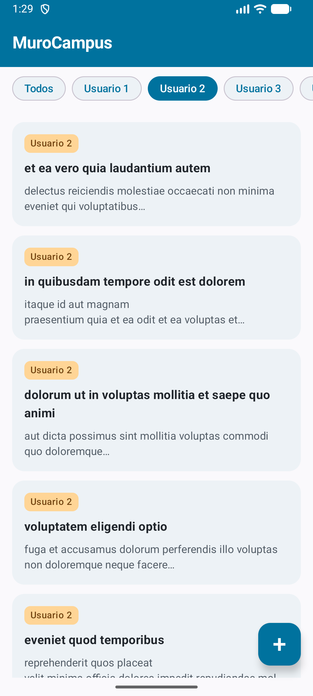

Usuario 2 seleccionado y publicaciones obtenidas mediante `posts?userId=2`.

### Creación de publicación

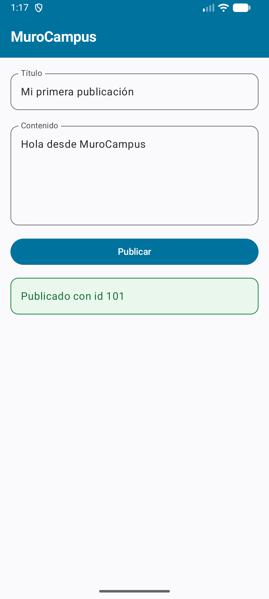

Formulario enviado desde MuroCampus y confirmación «Publicado con id 101», correspondiente a la respuesta HTTP 201 observada.

### Error de conexión


Error real de lista al seleccionar Usuario 3 sin conexión, con Reintentar disponible. La conectividad se restauró después de capturarlo.

## 11. Preguntas para pensar

### 1. ¿Qué diferencia hay entre GET y POST? ¿Por qué crear utiliza @Body y porUsuario utiliza @Query?

GET obtiene recursos y POST envía datos para crear uno. `@Body` serializa `NuevoPost` en el cuerpo de la solicitud. `@Query` agrega `userId` a la URL para indicar qué publicaciones queremos consultar.

### 2. ¿Por qué la ruta es posts y no /posts?

`posts` es una ruta relativa que se resuelve respecto a la URL base. Una ruta que comienza con `/` parte de la raíz del servidor y puede descartar segmentos de esa base. En JSONPlaceholder ambas podrían llegar al mismo endpoint porque la base está en la raíz, pero la forma relativa respeta el contrato y sirve también con bases que incluyen subrutas.

### 3. ¿Por qué el Repository devuelve Result en lugar de permitir que las excepciones lleguen directamente al ViewModel?

Permite entregar éxito o fallo desde la capa de datos, sin repetir su manejo en cada pantalla. El ViewModel transforma ese resultado en un estado de interfaz y resulta más fácil probarlo con un Repository falso. `CancellationException` se relanza para respetar la cancelación estructurada, no se trata como un error de negocio.

### 4. ¿Qué ocurre si olvidamos INTERNET? ¿Y si olvidamos ignoreUnknownKeys?

Sin el permiso INTERNET la aplicación no puede realizar normalmente las solicitudes de red. Sin `ignoreUnknownKeys`, kotlinx.serialization puede rechazar una respuesta que incluya propiedades no definidas en nuestros modelos. Esta opción tolera propiedades adicionales, pero no convierte cualquier JSON inválido o con tipos incorrectos en una respuesta válida.

### 5. ¿Por qué utilizar when sobre UiState y no tres variables independientes?

UiState representa situaciones mutuamente excluyentes y evita combinaciones como cargar, mostrar éxito y mostrar error a la vez. `when` hace más clara la interfaz y el compilador ayuda a comprobar que se contemplan los estados posibles.

### 6. ¿Cómo cambiaría la aplicación si utilizara un servicio web real que guarda las publicaciones?

El POST crearía un recurso persistente y las consultas posteriores podrían recuperarlo. Habría que decidir cómo sincronizar la lista después de publicar. También podrían requerirse autenticación, validaciones adicionales y errores propios del backend. La separación actual permite conservar las capas y adaptar el acceso a datos.

## 12. Limitaciones de JSONPlaceholder

- La creación es simulada: el servidor devuelve una respuesta, pero no garantiza almacenamiento persistente.
- En la prueba realizada devolvió HTTP 201 e ID 101. La interfaz muestra el identificador de esa respuesta; no fija 101 en producción.
- Una consulta posterior puede no encontrar el recurso creado y `GET /posts` sigue entregando el conjunto original.
- La aplicación no inserta una publicación ficticia en la lista ni navega automáticamente a su supuesto detalle.
- El autor se fija en `userId = 1` porque no hay autenticación. El filtro de usuario no representa una sesión iniciada.
- No se añadió almacenamiento local para compensar estas limitaciones.

## 13. Observaciones

- Se mantiene compileSdk 37 para la configuración compatible del proyecto; targetSdk continúa en 36 y minSdk en 24.
- `ignoreUnknownKeys` permite tolerar propiedades adicionales sin duplicar modelos.
- StateFlow mantiene una fuente de estado observable para cada operación y el filtro activo.
- Los trabajos independientes y su comprobación de vigencia evitan mostrar respuestas obsoletas.
- Las pruebas con datos controlados complementan las solicitudes reales; no las sustituyen ni se presentan como si provinieran de internet.
- Al cambiar de conjunto, LazyColumn puede conservar su anclaje. Todos recupera las cien publicaciones aunque no necesariamente vuelva al primer elemento.
- Los once avances se separaron por responsabilidad para facilitar su revisión.

## 14. Conclusiones

1. Retrofit y sus anotaciones permiten consumir servicios REST y diferenciar correctamente rutas, consultas y cuerpos JSON.
2. MVVM + Repository ayuda a mantener las pantallas separadas del acceso a datos y facilita las pruebas.
3. Las corrutinas y StateFlow permiten manejar operaciones asíncronas y conservar estados sin bloquear la interfaz.
4. Validar los campos y representar los errores permite recuperarse sin perder el formulario ni enviar datos inválidos.
5. Los commits separados y las pruebas de regresión ayudan a integrar cada avance sin perder las funcionalidades anteriores.

## 15. Historial de desarrollo

Los hashes se muestran abreviados. El último avance corresponde a este commit de documentación; no se inserta su propio hash en el archivo.

| N.º | Commit | Hash abreviado |
|---:|---|---|
| 1 | `chore: importa proyecto base MuroCampus` | `e9a3fbf` |
| 2 | `chore(red): agrega permiso de internet y dependencias de Retrofit` | `1d98eb9` |
| 3 | `feat(model): agrega Post, Comentario y NuevoPost` | `32902d1` |
| 4 | `feat(api): define la interface PostApi con GET y POST` | `a80ea86` |
| 5 | `feat(red): crea RetrofitClient con OkHttp y conversor JSON` | `e491561` |
| 6 | `feat(data): agrega PostRepository que devuelve Result` | `90c6a22` |
| 7 | `feat(ui): lista de publicaciones con estados Cargando, Exito y Error` | `74e93ec` |
| 8 | `feat(detalle): muestra publicacion y comentarios con Path` | `86fb00f` |
| 9 | `feat(filtro): filtra publicaciones por usuario con Query` | `68aac56` |
| 10 | `feat(crear): publica una nueva publicacion con POST y Body` | `f1ac3a9` |
| 11 | `docs: agrega README con estructura y capturas` | — |

## 16. Alcance de las ramas

- **main:** funcionalidades base del laboratorio: lista, estados, detalle, comentarios, filtro y creación, junto con pruebas y documentación.
- **con-ia:** rama existente reservada para una segunda fase de mejoras adicionales. No se implementaron ni publicaron esas mejoras durante esta primera fase y la rama se mantuvo intacta.

Se utilizó **OpenCode como apoyo de desarrollo** para la implementación, las pruebas, la documentación y las operaciones Git. Los resultados indicados se contrastaron con reportes y evidencias reales; no se presenta esta fase como un trabajo realizado sin asistencia de IA.

# Fase 2 — Mejoras con IA

Esta sección complementa la Fase 1 conservada arriba. Desarrollo en la rama
existente `con-ia` con **OpenCode** (no Gemini). MuroCampus no existía en esa rama:
se recuperaron sus **70 archivos versionados** desde
`8a67a4546970c047a5e6ea792a59f290e5d73481`, exclusivamente mediante
`git restore --source=<commit> --staged --worktree -- Semana09/MuroCampus/`.
No se fusionaron otras semanas ni los once commits de `main`; estos no se presentan
como ancestros de `con-ia`. La importación forma parte del primer avance para
respetar exactamente tres commits. La base pasó 163 pruebas unitarias y 40
instrumentadas, sin fallos, con 24 advertencias y cero errores de lint.

## A. Búsqueda por título

- `busqueda` conserva la consulta en el ViewModel. `resultados` usa `combine` y
  `stateIn` sobre `lista` y la consulta; `lista` sigue siendo la fuente descargada
  intacta. Solo se compara `title`, ignorando mayúsculas y espacios exteriores.
- El buscador Material 3 está sobre los filtros; permite limpiar y distingue
  ausencia de coincidencias de los estados de red. No llama al Repository al escribir.
- La consulta se aplica al cambiar de usuario y se conserva al volver del detalle
  y rotar. Crear publicaciones mantiene su comportamiento previo.
- Pruebas: **179 unitarias (16 nuevas), 46 instrumentadas (6 nuevas)**; cero
  fallos, errores u omitidas. Assemble, lint y repetición unitaria offline correctos;
  lint: 24 advertencias, cero errores. Se conservan las 203 pruebas base.
- Verificación real con Medium_Phone API 37: GET de 100 publicaciones; `qui` y
  `QUI` equivalentes, sin coincidencias, limpieza, Usuario 2 (10 publicaciones),
  detalle/regreso y rotación. Logcat confirma ausencia de GET por escritura.
  Error sin internet y reintento voluntario conservan consulta y filtro.
- Los registros completos, XML y capturas adicionales permanecen fuera de Git.

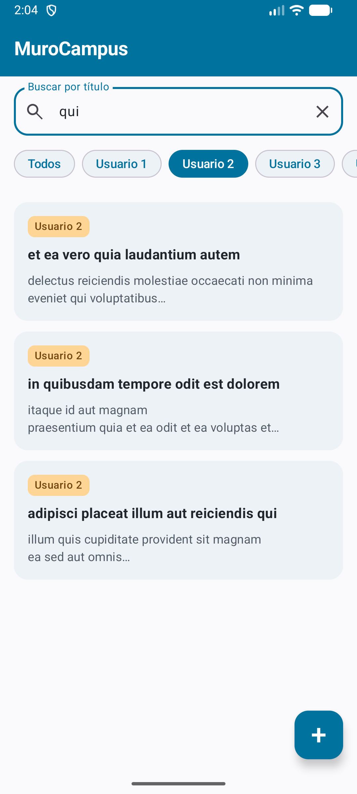

## Historial de Fase 2 (progresivo)

1. `feat(busqueda): agrega busqueda de publicaciones por titulo` — incluye base,
   búsqueda, pruebas y documentación. Los hashes publicados se consultan en Git.

El análisis y las decisiones se registran en [PROMPTS.md](PROMPTS.md).

---

## B. Eliminar publicaciones con DELETE

`PostApi.eliminar` usa `@DELETE("posts/{id}")`, `@Path` y `Response<Unit>`.
Repository verifica `isSuccessful`, convierte HTTP no exitoso en `HttpException`
en datos y devuelve `Result<Unit>`; la cancelación se relanza. El ViewModel solo
depende del Repository y mantiene estado/Job independientes, evita duplicados y
descarta respuestas obsoletas al cerrar o cambiar de detalle.

El botón rojo abre un diálogo Cancelar/Eliminar. Cancelar no envía nada; confirmar
conserva los datos mientras espera. Tras éxito regresa a la lista con confirmación.
Los IDs eliminados se excluyen de cargas posteriores durante la sesión, conservando
consulta y filtro. Un fallo mantiene el detalle y permite volver a confirmar.

**Comprobación real:** MuroCampus envió `DELETE /posts/1`, recibió **HTTP 200** y
`{}`. Se comprobó cancelación sin DELETE y exclusión al buscar/cambiar de filtro y
volver a Todos. Otro post (id 2) falló sin conexión; el detalle se conservó y un
reintento voluntario conectado obtuvo HTTP 200. Ajustes del emulador restaurados.

**JSONPlaceholder simula la escritura:** hubo HTTP real, no eliminación permanente.
La exclusión es memoria del ViewModel; reiniciar completamente puede recuperar los
datos originales. No hay Room, DataStore ni persistencia remota implementada.

Pruebas del avance: **200 unitarias y 50 instrumentadas** (21 y 4 nuevas frente a
búsqueda), cero fallos/errores/omitidas; assemble, lint y repetición unitaria offline
correctos. Lint: 24 advertencias, cero errores. Se adaptaron todos los fakes y el
contrato de seis operaciones sin debilitar las comprobaciones anteriores.

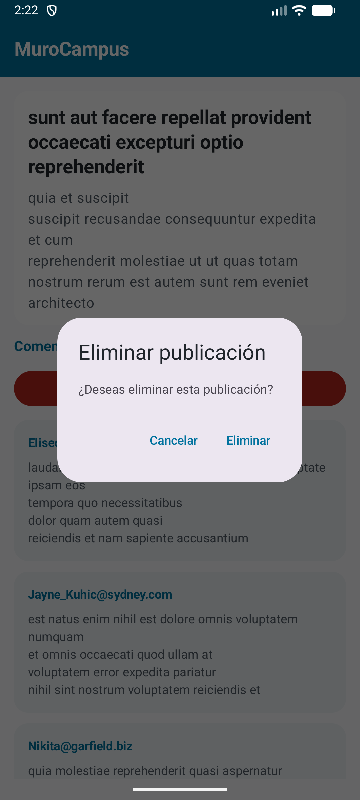
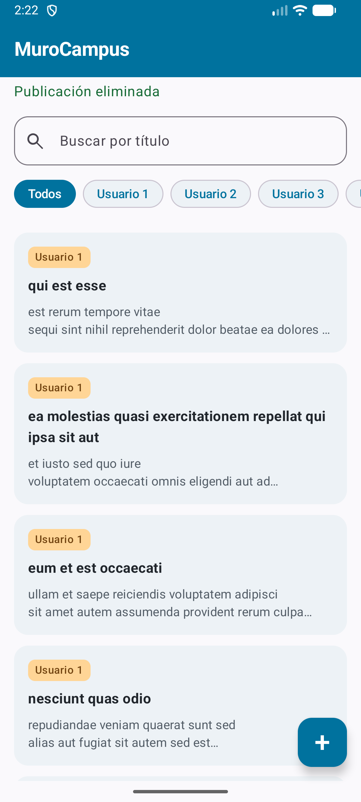

Segundo avance: `feat(eliminar): permite eliminar publicaciones con DELETE`.

### Cambio documental externo respetado

Durante el desarrollo se detectó `544e1ca5ce1cfdca742510b34dffba2d590c4ea8`
(`Update README.md`) en `main` remota, hijo directo del `main` local original
`8a67a4546970c047a5e6ea792a59f290e5d73481`. Solo modifica este README, retirando
sus secciones finales de Fase 1; fuente, pruebas y dependencias permanecen iguales.
El usuario autorizó continuar sin integrarlo ni sincronizar ambas referencias.
No se modificó ni publicó `main`; `con-ia` conserva la documentación base original.

## C. Editar títulos con PATCH

`EditarPost(val title: String)` es serializable y representa únicamente el campo
modificado. `@PATCH("posts/{id}")` recibe `@Path id`, `@Body EditarPost` y devuelve
`Post`. Repository retorna `Result<Post>` mediante su mismo manejo de excepciones
y cancelación. No se envían id, userId ni body en el JSON de actualización.

`PantallaEditar.kt` muestra título precargado y contenido original. Usa
`rememberSaveable(id)` para el borrador y `collectAsStateWithLifecycle` para los
estados. Guardar se deshabilita con título vacío, sin cambios o solicitud pendiente;
no se envía PATCH al escribir o rotar. Un error conserva lo escrito y permite
reintento; el éxito muestra confirmación verde y permite volver al detalle.

El ViewModel tiene estado/Job/versión independientes para edición, valida también
el título y evita duplicados. Utiliza **el Post devuelto**, actualiza lista y detalle
sin perder comentarios, consulta ni filtro. Un mapa por ID aplica esas respuestas a
cargas y detalles posteriores durante la sesión; los IDs eliminados tienen prioridad
y una eliminación exitosa cancela una edición pendiente. Volver al detalle desde
el formulario no vuelve a descargar lista ni comentarios.

### HTTP real comprobado desde MuroCampus

```http
PATCH https://jsonplaceholder.typicode.com/posts/2
Content-Type: application/json; charset=utf-8
```

```json
{"title":"Título actualizado desde MuroCampus"}
```

Logcat registró **HTTP 200** y un Post con `id=2`, `userId=1`, ese título y el
`body` original íntegro. Se verificaron los cinco comentarios, detalle, búsqueda
por `actualizado`, filtros y recarga dentro de la sesión. En la misma ejecución se
eliminó id 1 y el título editado de id 2 siguió disponible. Un intento offline
conservó el borrador; el reintento conectado produjo el éxito documentado. La
rotación real conservó el título sin PATCH automático. Se restauraron ajustes.

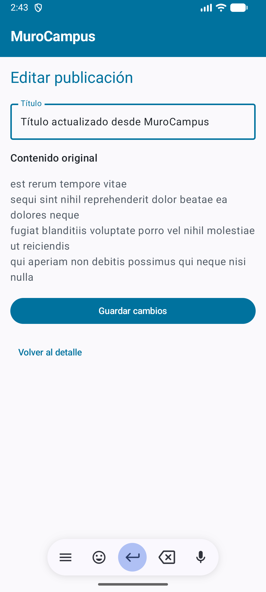
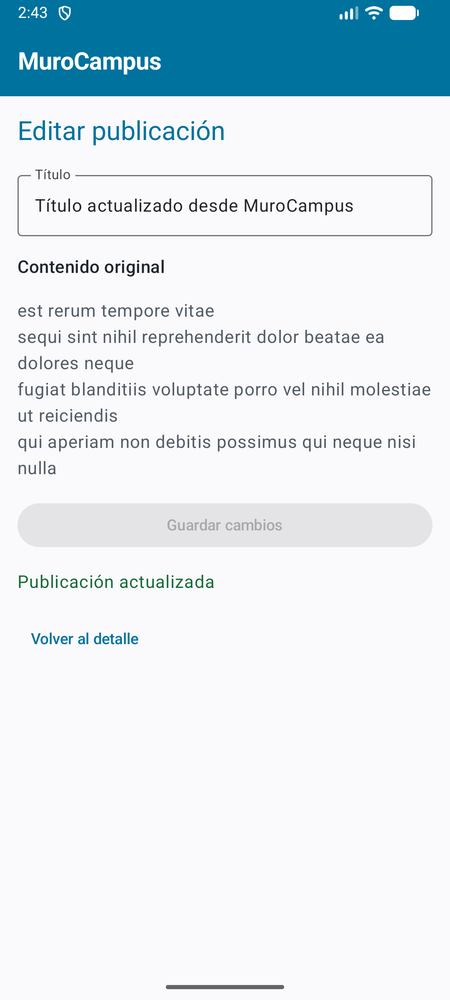

JSONPlaceholder **no persiste permanentemente PATCH ni DELETE**. Estas estructuras
de sesión son memoria local, no almacenamiento definitivo. No sobreviven a la
muerte del proceso. Las respuestas reales se contrastaron con Logcat de la app;
no se sustituyeron por curl ni por resultados fijados en producción.

## Arquitectura y contrato finales

```text
Compose → PostsViewModel (StateFlow, viewModelScope)
       → PostRepository (Result) → PostApi (Retrofit) → JSONPlaceholder

model/Modelos.kt                Post, Comentario, NuevoPost, Usuario, EditarPost
data/PostRepository.kt          siete operaciones y manejo de errores/cancelación
data/remote/PostApi.kt          cuatro GET + POST + DELETE + PATCH
viewmodel/PostsViewModel.kt     lista, resultados/busqueda, detalle, creacion,
                               eliminacion, edicion; exclusiones/actualizaciones
ui/PantallaLista.kt             búsqueda + chips + tarjetas
ui/PantallaDetalle.kt           publicación/comentarios + Editar/Eliminar
ui/PantallaCrear.kt             creación original
ui/PantallaEditar.kt            formulario PATCH
evidencias/con-ia/              cinco capturas reales de Fase 2
```

| Operación | Método y ruta | Resultado Repository |
| --- | --- | --- |
| listar | GET posts | Result de lista Post |
| detalle | GET posts/{id} | Result de Post |
| comentarios | GET posts/{id}/comments | Result de lista Comentario |
| porUsuario | GET posts?userId=… | Result de lista Post |
| crear | POST posts | Result de Post |
| eliminar | DELETE posts/{id} | Result de Unit (Response verificada en datos) |
| editar | PATCH posts/{id} | Result de Post (Body EditarPost) |

ViewModel sin Retrofit, PostApi, HttpException, Context ni GlobalScope; pantallas
sin acceso directo a Repository/API. Sin llamadas bloqueantes de UI ni cambios de
TLS, versiones o dependencias. Los jobs tienen cancelación/guardas de obsolescencia.
MainActivity conserva una sola Activity y navegación saveable lista/detalle/crear/editar.

## Pruebas finales de Fase 2

| Momento | Unitarias | Instrumentadas | Total sin repetir ejecuciones |
| --- | ---: | ---: | ---: |
| Base | 163 | 40 | 203 |
| Búsqueda | 179 | 46 | 225 |
| DELETE | 200 | 50 | 250 |
| PATCH/final | **228** | **57** | **285** |

Nuevas respecto a base: **65 unitarias + 17 instrumentadas = 82**. El tercer
avance añade 28 unitarias y 7 instrumentadas. Cero fallos, errores u omitidas en
los resultados finales; se conservaron todas las pruebas anteriores y las
comprobaciones de las operaciones originales. El test de cantidad de operaciones
conserva su nombre histórico, pero su expectativa final es de siete operaciones.

Se ejecutaron assembleDebug, testDebugUnitTest, lintDebug, la repetición unitaria
`--offline --rerun-tasks` y connectedDebugAndroidTest en Medium_Phone API 37.
BUILD SUCCESSFUL; lint: **24 advertencias y cero errores**. Las pruebas controladas
incluyen fakes explícitos y tráfico HTTP local a un servidor JVM para PATCH/DELETE;
ese transporte usa Retrofit y serialización reales sin internet. No es evidencia
de persistencia del proveedor. Las pruebas reales del emulador están separadas de
esas pruebas controladas. XML, Logcat y JSON completos permanecen fuera del repositorio.

## Historial de los tres avances originales y comparación de ramas

| Avance | Mensaje exacto | Referencia |
| --- | --- | --- |
| 1 | feat(busqueda): agrega busqueda de publicaciones por titulo | `6ea77eb9bc7c933844601e3aa70fb267054dc5d3` |
| 2 | feat(eliminar): permite eliminar publicaciones con DELETE | `a4f187671e7782895284eabb88c62832985d8ca6` |
| 3 | feat(editar): permite editar publicaciones con PATCH | commit que contiene esta sección; consultar Git |

`main` local representa Fase 1, sin buscador, DELETE, PATCH, PantallaEditar ni PROMPTS.
`con-ia` añade exactamente las tres mejoras, pruebas, documentación y cinco capturas;
las cinco evidencias originales y todo el contenido académico de Fase 1 se mantienen.
Las diferencias preexistentes de otros laboratorios entre ramas no se fusionaron.
Su integridad se compara contra la línea base de cada rama, no entre ramas.

Para repetir la comparación con el proyecto limpio y sin cambios preparados:

```powershell
# Desde la raíz del repositorio; no ejecutar pull ni forzar checkout.
git checkout main
# Desde Semana09/MuroCampus:
.\gradlew.bat :app:assembleDebug
# Instalar app/build/outputs/apk/debug/app-debug.apk y abrir MuroCampus.
# Desde la raíz:
git checkout con-ia
# Desde Semana09/MuroCampus, recompilar e instalar la APK de esta rama.
.\gradlew.bat :app:assembleDebug
```

La comprobación de cierre se realiza después del tercer push, con capturas externas
`comparacion-main.png` y `comparacion-con-ia.png`, sin cuarto commit documental.
Su resultado, hashes finales e integridad se informan al usuario al terminar.

- [Fase 2 en GitHub](https://github.com/mfernandezc-dev/Moviles_Fernandez/tree/con-ia/Semana09/MuroCampus)
- [Fase 1 en main remota](https://github.com/mfernandezc-dev/Moviles_Fernandez/tree/main/Semana09/MuroCampus)
- [Registro transparente de prompts y revisión pendiente del estudiante](PROMPTS.md)

## Corrección posterior autorizada — publicaciones de sesión y navegación

Esta sección describe el **estado vigente después de los tres avances originales**.
Se autorizó expresamente un commit adicional, sin reescribir los anteriores:
`fix(ui): corrige navegacion y visualizacion de publicaciones creadas`.
El historial de Fase 2 conserva sus tres commits originales; esta corrección es
un cuarto commit posterior, no una modificación de aquellos ni de `main`.

### Publicaciones creadas visibles y utilizables

Antes, el POST mostraba el éxito, pero su respuesta no se incorporaba a la lista.
Ahora PostsViewModel conserva el **Post recibido** en una colección local observable.
La vista derivada combina lista descargada, publicaciones locales, filtro y búsqueda:
las nuevas aparecen primero, respetando el `userId` recibido. El contrato `lista`
sigue representando los datos descargados; no se destruye ni se fuerza un nuevo GET
al publicar o regresar. El autor del formulario sigue siendo Usuario 1, aunque el
filtro activo sea otro; una publicación de ese autor no aparece bajo Usuario 2.

JSONPlaceholder puede devolver **id 101 en cada POST**. Por ello:

- La respuesta original (con id 101) se conserva y se muestra como éxito de creación.
- Cada copia de sesión tiene una **clave local negativa única** (`-1`, `-2`, …),
  utilizada como ID de navegación y clave estable de LazyColumn. No es un ID remoto.
- Las tarjetas y el detalle muestran una etiqueta de publicación local.
- Abrir una local muestra sus datos y cero comentarios sin consultar al servidor.
- Editar y eliminar locales solo modifican esa colección: **no envían GET, PATCH
  ni DELETE**, ni sobre id 101 ni sobre las claves negativas.
- Las publicaciones originales siguen utilizando GET, PATCH y DELETE reales por
  medio del Repository. La interfaz PostApi y las dependencias no cambiaron.
- Cambiar de filtro o recargar no pierde ni duplica las copias de sesión. Editar
  una copia no afecta a otra que recibió el mismo id 101 del proveedor.

**No hay persistencia permanente:** la colección sobrevive a navegación y rotación
con ViewModel retenido, pero se pierde al terminar el proceso. No se agregó Room,
DataStore ni almacenamiento remoto. JSONPlaceholder continúa simulando escrituras.

### Regreso compartido

`TopAppBar.navigationIcon` muestra una flecha blanca accesible como **Volver** solo
en pantallas secundarias. La flecha, BackHandler y Volver al detalle usan la misma
función: crear/detalle → lista; editar → detalle. No hacen nuevas solicitudes HTTP.
Se conservan consulta, filtro, colección y desplazamiento.

Al volver de una creación exitosa iniciada desde la parte superior de la lista,
se mantiene visible el índice inicial para mostrar la tarjeta recién insertada:
así el ancla del antiguo primer elemento no la oculta. Si se abrió el formulario
desde una posición desplazada, se conserva ese elemento visible al regresar.

### Verificaciones de la corrección

- **248 unitarias + 65 instrumentadas = 313 pruebas únicas**, todas aprobadas,
  cero fallos, errores u omitidas. Se conservan las 285 pruebas anteriores sin
  modificar sus archivos; se agregan 20 unitarias y 8 Compose.
- Assemble, testDebugUnitTest, lintDebug y connectedDebugAndroidTest correctos.
  Lint mantiene **24 advertencias y cero errores**.
- Emulador disponible: **Catalogo_H11_C, API 37**, sin sustituir ni borrar otras apps.
- Prueba real: POST `Tecsup`/`moviles` → **HTTP 201**, id 101; flecha al volver,
  tarjeta visible, búsqueda, detalle local, edición a `Tecsup actualizado`, búsqueda
  actualizada y eliminación local. Edición y eliminación locales también se
  comprobaron sin conexión; Logcat no registra HTTP adicional en ese recorrido.
- Dos nuevos POST (`Tecsup uno`, `Tecsup dos`) → **201/id 101 ambos**; dos tarjetas
  distintas, sin claves duplicadas ni cierres. Usuario 2 las oculta; Usuario 1 y
  Todos vuelven a mostrarlas tras nuevas cargas.
- Regresión remota real: `PATCH /posts/2` → **200**, JSON con solo `title`, cuerpo,
  autor e id conservados; cinco comentarios y búsqueda actualizados. El título
  efectivamente enviado fue `Publicacion remote corregida` (autocorrección de
  Gboard durante la entrada). `DELETE /posts/1` → **200**, `{}`.
- Sin solicitudes a `/posts/101` ni a IDs negativos; proceso estable, sin cierres
  inesperados. Conectividad y rotación del emulador restauradas.

Los registros técnicos completos y los XML están fuera del repositorio. Estas son
capturas reales seleccionadas, adicionales a las diez anteriores:

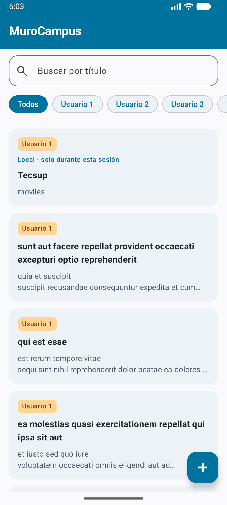
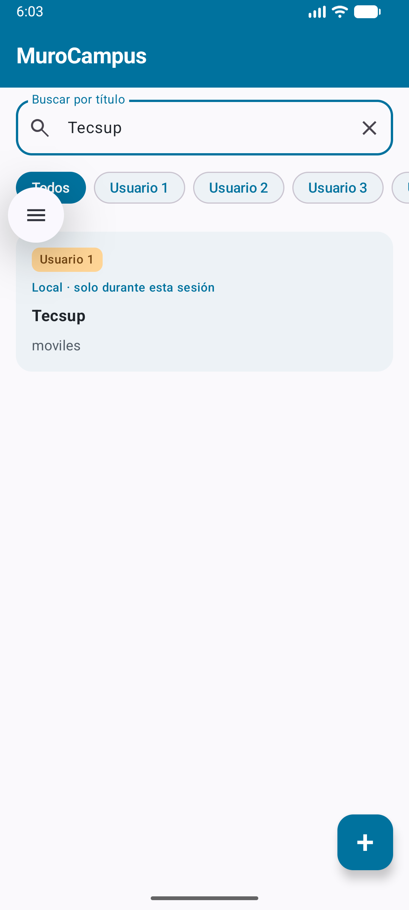
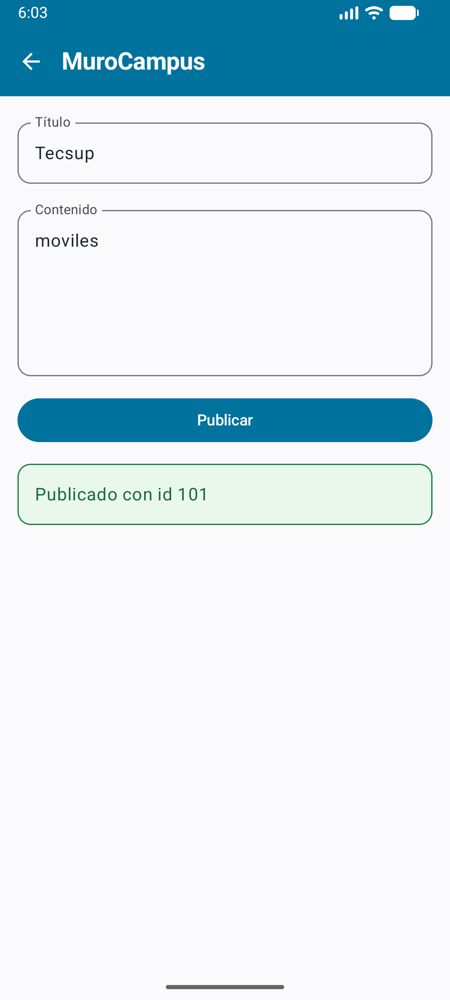
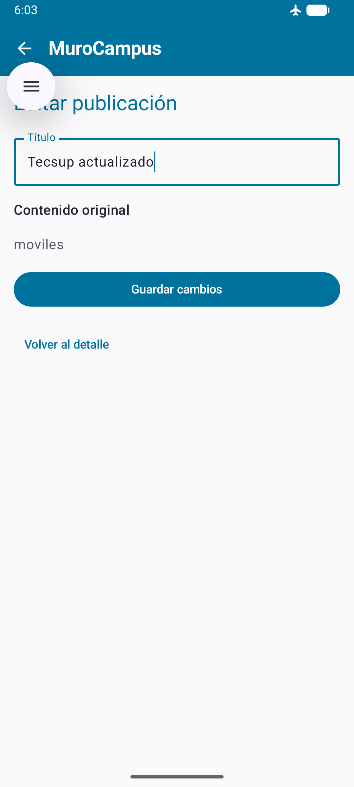
