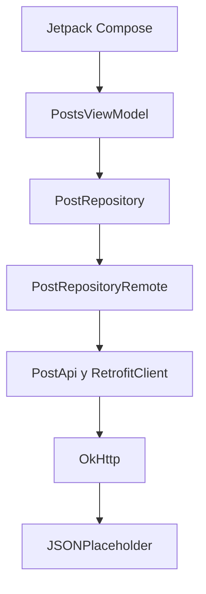
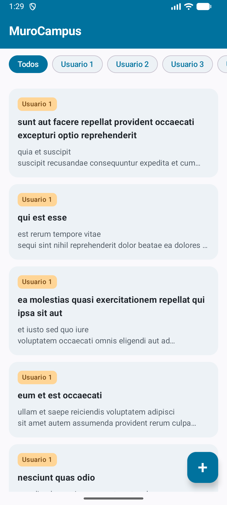
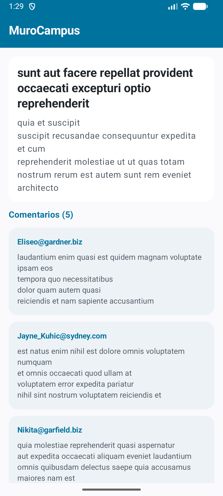
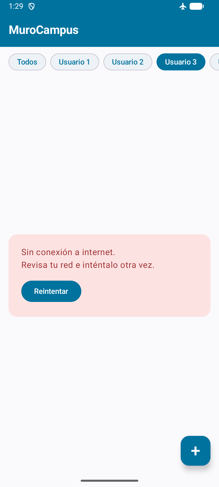

# MuroCampus

Laboratorio 09 — Programación en Móviles.

## 1. Descripción del proyecto

MuroCampus es una aplicación Android desarrollada con Kotlin, Jetpack Compose y Material 3. Consume los servicios REST de [JSONPlaceholder](https://jsonplaceholder.typicode.com/) para listar publicaciones, consultar su detalle y comentarios, filtrar por usuario y enviar una publicación de prueba.

La interfaz representa la carga, el éxito y los errores sin bloquear el hilo principal. La implementación base utiliza MVVM + Repository.

## 2. Objetivos

- Consumir servicios REST con Retrofit y OkHttp.
- Convertir JSON a modelos Kotlin mediante kotlinx.serialization.
- Ejecutar operaciones suspendidas con corrutinas y exponer sus estados con StateFlow.
- Separar presentación, estado y acceso a datos mediante MVVM + Repository.
- Manejar errores de conexión, HTTP y serialización con mensajes comprensibles.
- Aplicar GET y POST, parámetros de ruta con `@Path`, consultas con `@Query` y cuerpos con `@Body`.
- Verificar el funcionamiento con pruebas unitarias, instrumentadas y solicitudes reales.

## 3. Tecnologías utilizadas

Versiones declaradas en Gradle y en el catálogo del proyecto:

| Tecnología o configuración | Versión / valor |
|---|---|
| Android Gradle Plugin | 9.2.1 |
| Gradle Wrapper | 9.4.1 |
| Kotlin / plugins Compose y Serialization | 2.2.10 |
| Jetpack Compose y Material 3 | BOM 2026.02.01 |
| AndroidX Core KTX | 1.19.1 |
| Activity Compose | 1.13.0 |
| Lifecycle | 2.11.0 |
| Coroutines Android y Test | 1.9.0 |
| Retrofit y converter Kotlinx Serialization | 2.11.0 |
| Kotlinx Serialization JSON | 1.7.3 |
| OkHttp y Logging Interceptor | 4.12.0 |
| JUnit | 4.13.2 |
| AndroidX Test JUnit / Espresso | 1.3.0 / 3.7.0 |
| JDK del daemon Gradle | 21 |
| Compatibilidad Java del módulo | 11 |
| compileSdk / targetSdk / minSdk | 37 / 36 / 24 |
| BuildConfig | Habilitado |

El registro HTTP de OkHttp utiliza nivel BODY en debug y NONE en release. No se agregaron dependencias para la creación ni para la documentación final.

## 4. Arquitectura MVVM + Repository



- **Compose:** muestra los estados y comunica las acciones del usuario. Las pantallas observan los flujos con `collectAsStateWithLifecycle`.
- **PostsViewModel:** mantiene los estados independientes de lista, detalle y creación. Coordina corrutinas, filtro y cancelación; no conoce Retrofit ni utiliza Context.
- **PostRepository:** define operaciones suspendidas que devuelven `Result`.
- **PostRepositoryRemote:** delega en la API y transforma las excepciones ordinarias en fallos. Relanza `CancellationException`.
- **PostApi y RetrofitClient:** describen los endpoints y configuran URL base, cliente HTTP y conversor JSON.
- **MainActivity:** es el punto de composición de dependencias y navegación. Obtiene el ViewModel con `ViewModelProvider` y su factory; no ejecuta HTTP directamente.
- **MensajesError.kt:** transforma excepciones técnicas en mensajes de conexión, servidor, respuesta inesperada o error desconocido.

El flujo de datos vuelve a la interfaz mediante StateFlow. Cada operación mantiene un Job independiente para no cancelar, por ejemplo, la lista al cerrar el detalle o el formulario.

## 5. Estructura de paquetes

Código de producción en `app/src/main/java/`:

```text
com.fernandez.murocampus/
├── MainActivity.kt
├── model/
│   └── Modelos.kt
├── data/
│   ├── MensajesError.kt
│   ├── PostRepository.kt
│   └── remote/
│       ├── PostApi.kt
│       └── RetrofitClient.kt
├── viewmodel/
│   ├── UiState.kt
│   ├── PostsViewModel.kt
│   └── PostsViewModelFactory.kt
└── ui/
    ├── Componentes.kt
    ├── PantallaLista.kt
    ├── PantallaDetalle.kt
    ├── PantallaCrear.kt
    └── theme/
        ├── Color.kt
        ├── Theme.kt
        └── Type.kt
```

`Modelos.kt` contiene `Post`, `Comentario`, `NuevoPost` y `Usuario`. `UiState` representa Cargando, Exito y Error. `DetalleUi`, declarado en el archivo del ViewModel, reúne una publicación y sus comentarios. La creación utiliza `UiState<Post>?`: `null` significa que aún no se ha enviado el formulario.

`Componentes.kt` reúne la tarjeta de publicación, el indicador de carga y el error con reintento. Cada pantalla se ocupa de representar su estado. Las pruebas JVM están en `app/src/test/` y las pruebas Compose en `app/src/androidTest/`.

## 6. Servicio web REST

URL base: `https://jsonplaceholder.typicode.com/`.

Estas operaciones no requieren token de API.

| Método | Ruta relativa | Entrada | Respuesta Kotlin |
|---|---|---|---|
| GET | `posts` | Sin parámetros | `List<Post>` |
| GET | `posts/{id}` | `@Path("id") id: Int` | `Post` |
| GET | `posts/{id}/comments` | `@Path("id") id: Int` | `List<Comentario>` |
| GET | `posts?userId=2` | Ejemplo de `@Query("userId") userId: Int` | `List<Post>` |
| POST | `posts` | `@Body nuevo: NuevoPost` | `Post` |

`@GET` obtiene recursos y `@POST` envía datos de creación. `@Path` sustituye una parte de la ruta; `@Query` incorpora parámetros en la URL; `@Body` serializa un objeto dentro del cuerpo HTTP.

Ejemplo del cuerpo enviado por el formulario, con `Content-Type: application/json; charset=utf-8`:

```json
{
  "userId": 1,
  "title": "Mi primera publicación",
  "body": "Hola desde MuroCampus"
}
```

`NuevoPost` no incluye identificador. El identificador de la confirmación se obtiene del `Post` recibido, no de un valor fijo escrito en la interfaz.

## 7. Funcionalidades implementadas

- **Lista:** carga remota de publicaciones en una LazyColumn con claves por ID, título en negrita y cuerpo limitado a dos líneas.
- **Estados:** Cargando, Exito y Error mediante `when` sobre UiState. Una lista vacía válida muestra «Sin publicaciones».
- **Reintentar:** vuelve a consultar respetando el filtro activo.
- **Detalle:** solicita la publicación seleccionada y sus comentarios con `@Path`, mostrando el texto completo y `Comentarios (N)` según la respuesta.
- **Filtro:** once chips en una LazyRow: Todos y Usuario 1–10. Consulta `porUsuario(userId)` de forma remota; no sustituye la consulta por un filtrado local.
- **Creación:** FAB accesible en la lista, formulario con Título y Contenido, botón Publicar y confirmación verde con el ID recibido.
- **Validación:** campos vacíos o compuestos solo por espacios no permiten enviar. El ViewModel vuelve a validarlos y recorta sus extremos.
- **Errores de creación:** conserva los campos y permite volver a pulsar Publicar. No hay reintentos automáticos de POST.
- **Navegación:** una Activity, selección guardable y BackHandler. Al volver no se descarga la lista innecesariamente; se conservan filtro y desplazamiento.
- **Rotación:** conserva pantalla, selección, formulario y estado del ViewModel durante la recreación comprobada, sin repetir automáticamente solicitudes.
- **Concurrencia:** evita envíos simultáneos duplicados y cancela o invalida resultados obsoletos con trabajos y versiones independientes.

Atrás permite salir del formulario y cancela el trabajo local pendiente. **Cancelar la corrutina no revierte un POST que ya llegó al servidor.** Si un envío falla, no debe asumirse que el servidor nunca lo recibió; el usuario decide si vuelve a publicar.

## 8. Instrucciones de ejecución

```bash
git clone https://github.com/mfernandezc-dev/Moviles_Fernandez.git
```

Abrir este proyecto, no los otros laboratorios del repositorio:

```text
Moviles_Fernandez/Semana09/MuroCampus
```

1. Abrir la carpeta MuroCampus en Android Studio compatible con AGP 9.2.1.
2. Configurar un JDK 21 compatible para Gradle; el proyecto declara esa versión en `gradle/gradle-daemon-jvm.properties`.
3. Instalar Android SDK Platform 37 y las herramientas solicitadas por Android Studio.
4. Sincronizar Gradle y permitir la descarga inicial de dependencias.
5. Seleccionar un dispositivo o emulador con Android API 24 o superior. Las verificaciones de este laboratorio utilizaron Medium_Phone, API 37.
6. Ejecutar la aplicación y comprobar la conexión a internet.

`local.properties` configura localmente la ruta del SDK y no está publicado. No es necesario copiar rutas privadas de otra computadora ni configurar un token de JSONPlaceholder.

Desde la carpeta del proyecto, en PowerShell:

```powershell
.\gradlew.bat :app:assembleDebug
.\gradlew.bat :app:testDebugUnitTest
.\gradlew.bat :app:lintDebug
```

Con un dispositivo conectado y reconocido por ADB:

```powershell
.\gradlew.bat :app:connectedDebugAndroidTest
```

Con las dependencias ya disponibles en caché, también se verificaron las unitarias sin acceso a repositorios remotos:

```powershell
.\gradlew.bat :app:testDebugUnitTest --offline --rerun-tasks
```

Si HTTPS falla después de restaurar un snapshot, comprobar fecha y hora del emulador. No desactivar la validación TLS ni aceptar certificados indiscriminadamente.

## 9. Pruebas realizadas

Resultados de la implementación definitiva del Commit 10, comprobados nuevamente durante el cierre de documentación. Las ejecuciones repetidas no cuentan como pruebas diferentes.

| Verificación | Resultado | Tipo de evidencia |
|---|---|---|
| Compilación debug | BUILD SUCCESSFUL | Gradle |
| Pruebas unitarias | **163 aprobadas** | JVM, Repository falso y comprobaciones de contrato |
| Pruebas instrumentadas | **40 aprobadas** | Compose con respuestas controladas |
| Fallos / errores / omitidas | **0 / 0 / 0** | Reportes XML de ambas suites |
| Total de pruebas diferentes | **203** | 163 + 40 |
| Lint | **24 advertencias y 0 errores** | Reporte de lint, sin aumento frente al Commit 9 |
| GET de lista | HTTP 200 y 100 publicaciones | Aplicación real y Logcat |
| Detalle y comentarios de publicación 1 | HTTP 200 en ambas consultas; cinco comentarios | Aplicación real, Logcat e interfaz |
| Usuario 1–10 | HTTP 200; diez publicaciones por usuario, todos los `userId` correctos | Comprobación real del Commit 9, conservada como evidencia |
| Regresión de Todos y Usuario 2 | 100 y diez publicaciones respectivamente | APK definitiva del Commit 10 |
| POST del formulario | **HTTP 201**, ID **101**, título y contenido coincidentes | Solicitud y respuesta reales de MuroCampus |
| Error sin internet | Error visible en lista y creación | Conexión desactivada solo en el emulador |
| Recuperación | Reintentar en lista y nuevo intento voluntario en creación correctos | Aplicación real; creación volvió a recibir HTTP 201 |
| Conservación de campos | Título y contenido intactos tras el error | Interfaz real y pruebas Compose |
| Rotación del formulario | Conserva borrador y confirmación; POST 0→0 y 1→1 | Recreación real de Activity y Logcat |
| Regreso desde creación | Usuario 2 y desplazamiento conservados; GET 2→2 | Aplicación real |
| HTTP 404 y 500, serialización y cancelación | Casos aprobados | Pruebas controladas; no se presentan como fallos HTTP reales del proveedor |

Las 132 unitarias y 25 instrumentadas anteriores se conservaron. La creación añadió 31 unitarias y 15 instrumentadas.

Los estados pendientes de carga y publicación, las listas vacías y las respuestas tardías se verificaron de forma determinista con Repository falsos. La evidencia de Cargando no se presenta como una captura de una solicitud real en curso. Las cinco imágenes siguientes sí proceden de interacciones reales con la API, salvo el error real provocado al desconectar el emulador.

No se verificó persistencia ante muerte del proceso. La conservación de estado documentada corresponde a rotación y restauración de estado comprobadas. Las advertencias de lint incluyen versiones más recientes disponibles y recursos existentes sin uso; no se ocultaron mediante desactivación de verificaciones.

## 10. Evidencias de funcionamiento

Las cinco capturas corresponden a la APK definitiva de la implementación del Commit 10 (`f1ac3a9`), ejecutada en Medium_Phone, API 37. Se conservaron los originales y no se editaron las imágenes para alterar resultados. Los correos del detalle pertenecen a los datos públicos de prueba de JSONPlaceholder, no a cuentas del dispositivo.

### Lista de publicaciones



Datos reales, Todos seleccionado, fila de filtros y FAB para abrir el formulario.

### Detalle y comentarios



Publicación 1 y encabezado Comentarios (5), con correos y cuerpos recibidos del servicio. No aparece el FAB.

### Filtro por usuario


Usuario 2 seleccionado y publicaciones obtenidas mediante `posts?userId=2`.

### Creación de publicación


Formulario enviado desde MuroCampus y confirmación «Publicado con id 101», correspondiente a la respuesta HTTP 201 observada.

### Error de conexión



Error real de lista al seleccionar Usuario 3 sin conexión, con Reintentar disponible. La conectividad se restauró después de capturarlo.

## 11. Preguntas para pensar

### 1. ¿Qué diferencia hay entre GET y POST? ¿Por qué crear utiliza @Body y porUsuario utiliza @Query?

GET obtiene recursos y POST envía datos para crear uno. `@Body` serializa `NuevoPost` en el cuerpo de la solicitud. `@Query` agrega `userId` a la URL para indicar qué publicaciones queremos consultar.

### 2. ¿Por qué la ruta es posts y no /posts?

`posts` es una ruta relativa que se resuelve respecto a la URL base. Una ruta que comienza con `/` parte de la raíz del servidor y puede descartar segmentos de esa base. En JSONPlaceholder ambas podrían llegar al mismo endpoint porque la base está en la raíz, pero la forma relativa respeta el contrato y sirve también con bases que incluyen subrutas.

### 3. ¿Por qué el Repository devuelve Result en lugar de permitir que las excepciones lleguen directamente al ViewModel?

Permite entregar éxito o fallo desde la capa de datos, sin repetir su manejo en cada pantalla. El ViewModel transforma ese resultado en un estado de interfaz y resulta más fácil probarlo con un Repository falso. `CancellationException` se relanza para respetar la cancelación estructurada, no se trata como un error de negocio.

### 4. ¿Qué ocurre si olvidamos INTERNET? ¿Y si olvidamos ignoreUnknownKeys?

Sin el permiso INTERNET la aplicación no puede realizar normalmente las solicitudes de red. Sin `ignoreUnknownKeys`, kotlinx.serialization puede rechazar una respuesta que incluya propiedades no definidas en nuestros modelos. Esta opción tolera propiedades adicionales, pero no convierte cualquier JSON inválido o con tipos incorrectos en una respuesta válida.

### 5. ¿Por qué utilizar when sobre UiState y no tres variables independientes?

UiState representa situaciones mutuamente excluyentes y evita combinaciones como cargar, mostrar éxito y mostrar error a la vez. `when` hace más clara la interfaz y el compilador ayuda a comprobar que se contemplan los estados posibles.

### 6. ¿Cómo cambiaría la aplicación si utilizara un servicio web real que guarda las publicaciones?

El POST crearía un recurso persistente y las consultas posteriores podrían recuperarlo. Habría que decidir cómo sincronizar la lista después de publicar. También podrían requerirse autenticación, validaciones adicionales y errores propios del backend. La separación actual permite conservar las capas y adaptar el acceso a datos.

## 12. Limitaciones de JSONPlaceholder

- La creación es simulada: el servidor devuelve una respuesta, pero no garantiza almacenamiento persistente.
- En la prueba realizada devolvió HTTP 201 e ID 101. La interfaz muestra el identificador de esa respuesta; no fija 101 en producción.
- Una consulta posterior puede no encontrar el recurso creado y `GET /posts` sigue entregando el conjunto original.
- La aplicación no inserta una publicación ficticia en la lista ni navega automáticamente a su supuesto detalle.
- El autor se fija en `userId = 1` porque no hay autenticación. El filtro de usuario no representa una sesión iniciada.
- No se añadió almacenamiento local para compensar estas limitaciones.

## 13. Observaciones

- Se mantiene compileSdk 37 para la configuración compatible del proyecto; targetSdk continúa en 36 y minSdk en 24.
- `ignoreUnknownKeys` permite tolerar propiedades adicionales sin duplicar modelos.
- StateFlow mantiene una fuente de estado observable para cada operación y el filtro activo.
- Los trabajos independientes y su comprobación de vigencia evitan mostrar respuestas obsoletas.
- Las pruebas con datos controlados complementan las solicitudes reales; no las sustituyen ni se presentan como si provinieran de internet.
- Al cambiar de conjunto, LazyColumn puede conservar su anclaje. Todos recupera las cien publicaciones aunque no necesariamente vuelva al primer elemento.
- Los once avances se separaron por responsabilidad para facilitar su revisión.

## 14. Conclusiones

1. Retrofit y sus anotaciones permiten consumir servicios REST y diferenciar correctamente rutas, consultas y cuerpos JSON.
2. MVVM + Repository ayuda a mantener las pantallas separadas del acceso a datos y facilita las pruebas.
3. Las corrutinas y StateFlow permiten manejar operaciones asíncronas y conservar estados sin bloquear la interfaz.
4. Validar los campos y representar los errores permite recuperarse sin perder el formulario ni enviar datos inválidos.
5. Los commits separados y las pruebas de regresión ayudan a integrar cada avance sin perder las funcionalidades anteriores.


