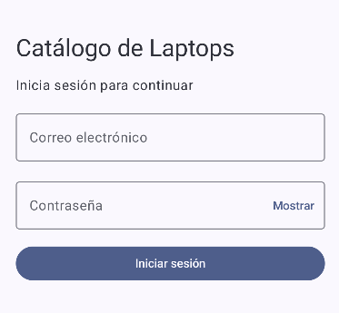
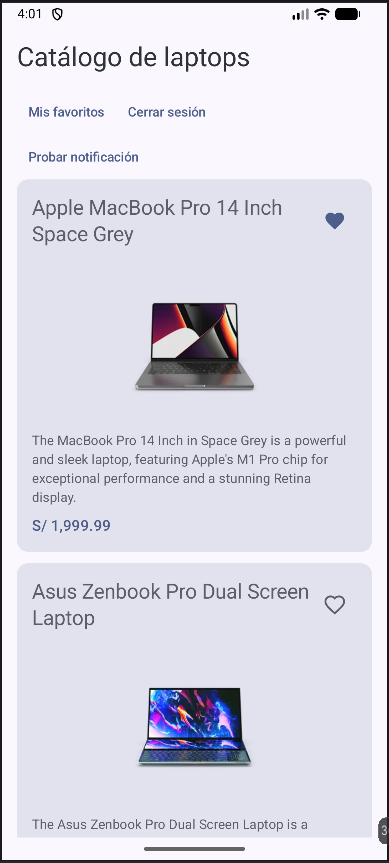
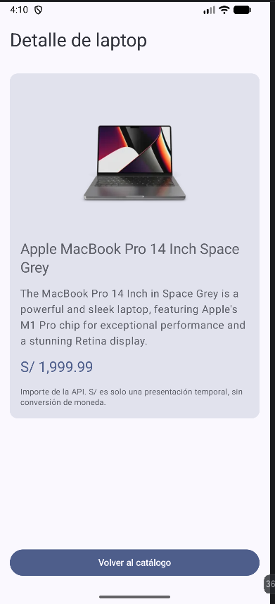
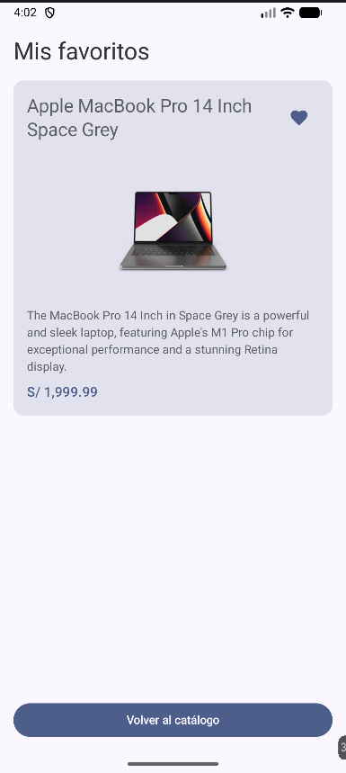

# Catálogo de Laptops — Laboratorio 11-12

## 1. Presentación

Aplicación Android desarrollada en Kotlin con Jetpack Compose y arquitectura MVVM para el curso de Programación en Móviles de Tecsup.

El proyecto consulta un catálogo de laptops desde una API REST, conserva datos y favoritos con Room e integra Firebase para la autenticación y los roles. También permite probar una notificación local de Android.

**Tema:** productos. **Variante:** categoría `laptops` de DummyJSON. Esta documentación describe la implementación existente hasta H15.

[Proyecto en GitHub](https://github.com/mfernandezc-dev/Moviles_Fernandez/tree/main/Semana12/Catalogo)

## 2. Objetivo

Construir una aplicación de consulta que integre servicios de internet, almacenamiento local y acceso por roles. El laboratorio permite practicar la separación de responsabilidades, el manejo de estados de pantalla y la recuperación ante errores de conexión.

## 3. Tecnologías utilizadas

Las versiones declaradas se pueden revisar en [libs.versions.toml](gradle/libs.versions.toml), [app/build.gradle.kts](app/build.gradle.kts) y [gradle-wrapper.properties](gradle/wrapper/gradle-wrapper.properties).

| Tecnología | Configuración del proyecto |
| --- | --- |
| Kotlin | `2.2.10` para los plugins de Compose y serialización |
| Jetpack Compose y Material 3 | Versiones gestionadas por Compose BOM `2026.02.01` |
| MVVM | Patrón de organización de las capas |
| Retrofit | `2.11.0`, con convertidor Kotlin Serialization |
| Kotlin Serialization | JSON `1.7.3` |
| OkHttp | Cliente e interceptor de registros `4.12.0` |
| DummyJSON | Servicio REST público para los productos |
| Room | `2.8.5`; generación de código mediante KSP `2.3.6` |
| Coroutines y Flow | Operaciones asíncronas y estados observables; sin versión fijada directamente en el catálogo |
| Firebase Authentication y Cloud Firestore | Versiones gestionadas por Firebase BOM `34.19.0` |
| Navigation Compose | `2.8.4` |
| Notificaciones locales Android | `NotificationCompat`, con AndroidX Core KTX `1.19.1` |
| Gradle Kotlin DSL | Gradle Wrapper `9.4.1` y Android Gradle Plugin `9.2.1` |

El plugin Google Services está configurado en la versión `4.5.0`. El proyecto utiliza `compileSdk 37.1`, `targetSdk 36` y `minSdk 24`.

## 4. Arquitectura del proyecto

El flujo general es **UI → ViewModel → Repository → Room / Retrofit / Firebase**. Las notificaciones se solicitan mediante una interfaz independiente:

```text
Pantallas Compose → ViewModels
                       ├── ItemRepository → ItemRepositoryImpl
                       │                        ├── Room: catálogo y favoritos locales
                       │                        └── Retrofit: lista y detalle de DummyJSON
                       ├── AuthRepository → FirebaseAuthRepository
                       │                        ├── Firebase Authentication: sesión
                       │                        └── Firestore: rol del usuario
                       └── Notificador → NotificadorAndroid
```

- **Compose** representa las pantallas y observa los estados que exponen los ViewModels.
- **ViewModel** gestiona las acciones y los estados de carga, éxito y error con `UiState` y `StateFlow`.
- **Repository** abstrae el acceso a datos mediante interfaces, sin vincular los ViewModels a las implementaciones concretas.
- **Retrofit** descarga productos y consulta el detalle. La lista descargada se guarda en Room.
- **Room** es la fuente de datos de las pantallas de catálogo y favoritos; el detalle se consulta directamente a la API.
- **Firebase Authentication** mantiene la sesión y **Firestore** proporciona el rol que autoriza la navegación.
- **NotificadorAndroid** utiliza `NotificationCompat` y administra el canal de notificaciones.

`AppContainer` construye las dependencias, y las factorías de ViewModel las reciben desde allí. Los mappers convierten `ItemDto` (API), `ItemEntity` (Room) e `Item` (modelo usado por la UI).

## 5. Estructura de carpetas

Paquete principal: [app/src/main/java/com/fernandez/catalogo](app/src/main/java/com/fernandez/catalogo).

```text
com.fernandez.catalogo/
├── AppContainer.kt
├── MainActivity.kt
├── data/
│   ├── auth/          AuthRepository.kt, FirebaseAuthRepository.kt
│   ├── local/         ItemEntity.kt, ItemDao.kt, AppDatabase.kt
│   ├── mapper/        Mappers.kt
│   ├── remote/        ApiService.kt, RetrofitClient.kt
│   │   └── dto/       ItemDto.kt
│   └── repository/    ItemRepository.kt, ItemRepositoryImpl.kt
├── domain/
│   └── model/         Item.kt, Sesion.kt
├── notification/      Notificador.kt, NotificadorAndroid.kt
└── ui/
    ├── UiState.kt
    ├── admin/         AdminScreen.kt, AdminViewModel.kt
    ├── components/    Cargando.kt, ErrorView.kt
    ├── detalle/       DetalleScreen.kt, DetalleViewModel.kt
    ├── favoritos/     FavoritosScreen.kt, FavoritosViewModel.kt
    ├── lista/         ListaScreen.kt, ListaViewModel.kt
    ├── login/         LoginScreen.kt, LoginViewModel.kt
    ├── navigation/    AppNav.kt
    └── theme/         Color.kt, Theme.kt, Type.kt
```

## 6. Funcionalidades

1. Inicio de sesión con correo electrónico y contraseña, con validación de campos y mensajes de error.
2. Persistencia de la sesión mediante Firebase Authentication al reabrir la aplicación.
3. Cierre de sesión y retorno al login, descartando la navegación protegida de la sesión anterior.
4. Acceso por roles: `USER` ingresa al catálogo; `ADMIN` inicia en el panel administrativo y puede abrir el catálogo.
5. Catálogo de laptops con estados de carga, error y lista vacía.
6. Consulta del detalle de un producto mediante el segundo endpoint de la API.
7. Marcado y desmarcado de favoritos, con una pantalla para consultarlos y conservación al cerrar la app y sincronizar.
8. Persistencia del catálogo y los favoritos en la base local `catalogo.db`, tabla `items`.
9. Consulta del catálogo y los favoritos sin internet cuando hay datos guardados y una sesión ya autorizada.
10. Recuperación mediante **Reintentar** ante fallos de actualización, detalle o validación del perfil.
11. Panel administrativo con los totales de productos guardados y favoritos locales, acceso al catálogo y cierre de sesión.
12. Notificación local desde **Probar notificación**, con solicitud de `POST_NOTIFICATIONS` en Android 13 o posterior.

La notificación tiene el título **Catálogo de Laptops**, el mensaje **Notificación local de prueba** y el canal `catalogo_notificaciones` (**Notificaciones del catálogo**). Si se deniega el permiso, no se envía y la aplicación continúa funcionando. Un ID estable (`15`) actualiza el mismo aviso; abrir, rotar o recomponer la pantalla no lo genera automáticamente. No se utiliza Firebase Cloud Messaging.

No se implementan registro de usuarios, compras, carrito ni pagos.

## 7. API REST

La aplicación consume dos endpoints públicos de solo lectura de **DummyJSON**, sin enviar credenciales de Firebase:

| Método y URL | Función |
| --- | --- |
| `GET https://dummyjson.com/products/category/laptops` | Obtiene la categoría de laptops; la respuesta contiene `products`, `total`, `skip` y `limit`. |
| `GET https://dummyjson.com/products/{id}` | Consulta el detalle del producto seleccionado, usando su identificador entero. |

El DTO recoge `id`, `title`, `description`, `price` y `thumbnail` (opcional). El repositorio guarda la lista en Room y conserva los identificadores marcados como favoritos al actualizar.

**Precios:** se muestra el importe recibido de la API. El prefijo `S/` es una presentación temporal: no existe conversión de moneda a soles.

## 8. Firebase

| Configuración | Valor |
| --- | --- |
| Project ID | `miappventas-5ea6a` |
| Aplicación Android | `com.fernandez.catalogo` |
| Authentication | Correo electrónico/contraseña |
| Base de Cloud Firestore | `(default)` |
| Colección de perfiles | `catalogo_usuarios` |
| ID del documento | UID del usuario autenticado |
| Campo de autorización | `rol` |
| Valores admitidos | `USER` y `ADMIN` (en mayúsculas) |

La aplicación consulta el perfil del usuario autenticado en `catalogo_usuarios/{uid}`. El rol se solicita al servidor; un perfil inexistente, un valor no admitido o un error de verificación bloquea el acceso protegido. No se asigna un rol administrativo como alternativa ante un fallo.

Los roles se asignan desde un entorno administrativo autorizado. La app no permite crear cuentas ni modificar roles. Para preparar cuentas de prueba en un entorno autorizado, el responsable debe habilitar el proveedor correo/contraseña en Authentication, dar de alta las cuentas y registrar el documento de cada UID con su campo `rol`. No se publican sus credenciales en este repositorio.

Las reglas de Firestore deben restringir la lectura al perfil propio y evitar que el cliente escriba los roles. La navegación por rol no sustituye esas reglas de seguridad; su configuración corresponde al responsable de Firebase.

## 9. Instalación y ejecución

1. Clonar o descargar el [repositorio Moviles_Fernandez](https://github.com/mfernandezc-dev/Moviles_Fernandez).
2. Abrir la carpeta **Semana12/Catalogo** en Android Studio, no la raíz de todos los laboratorios.
3. Utilizar Android Studio y un JDK compatibles con AGP `9.2.1` y Gradle `9.4.1`. Las compilaciones verificadas utilizaron JDK 17. Instalar el SDK requerido por `compileSdk 37.1`; el dispositivo de ejecución debe cumplir `minSdk 24`.
4. Esperar la sincronización de Gradle y la descarga de las dependencias.
5. Configurar el archivo local de Firebase y sincronizar de nuevo si es necesario.
6. Ejecutar la aplicación desde Android Studio en un emulador o dispositivo compatible, con conexión para el login y la validación inicial del rol.

### Archivo local de Firebase

El `google-services.json` de **Catalogo** está ignorado por Git y **no se encuentra en su carpeta de GitHub**. No se obtiene automáticamente al clonar.

Una persona autorizada debe descargar desde Firebase Console la configuración de la aplicación `com.fernandez.catalogo` y colocarla en:

```text
Semana12/Catalogo/app/google-services.json
```

Es decir, dentro del proyecto: `Catalogo/app/google-services.json`. Las pruebas de autenticación requieren una cuenta autorizada en Firebase Authentication y un perfil con rol válido en Firestore. El archivo JSON no reemplaza esa configuración.

### Compilación de depuración

Desde la terminal ubicada en **Catalogo**, ejecutar:

```powershell
.\gradlew.bat :app:assembleDebug
```

La configuración actual puede mostrar una advertencia porque AGP `9.2.1` fue probado hasta `compileSdk 37.0`, mientras el proyecto usa `37.1`. Las compilaciones registradas finalizaron con **BUILD SUCCESSFUL** sin cambiar esa configuración.

## 10. Pruebas realizadas

El resumen recoge las verificaciones registradas antes de esta documentación, principalmente en el emulador **Catalogo_H11_C**, Android API 37. Los registros existentes de OkHttp también confirman HTTP 200 para la lista y el detalle.

| Verificación | Resultado observado |
| --- | --- |
| API y catálogo | Respuestas HTTP 200 de DummyJSON y cinco laptops visibles. |
| Detalle con internet | Carga del producto seleccionado desde su endpoint. |
| Room | Cinco registros persistentes y comprobación de integridad correcta. |
| Favoritos | Marcado, consulta y desmarcado; persistencia tras reiniciar la app y actualizar el catálogo. |
| Catálogo offline | Catálogo y favoritos disponibles sin red con datos guardados y sesión ya autorizada. |
| Errores y recuperación | Error recuperable en el detalle sin conexión; recuperación con Reintentar al restaurar la red. Arranque offline bloqueado por la validación del perfil y recuperado al reconectar. |
| Login y sesión | Ingresos reales con Firebase, sesión conservada al reiniciar y logout con retorno al login. |
| Roles y navegación | USER entra al catálogo sin panel administrativo; ADMIN abre su panel y puede navegar al catálogo. `AppNav` restringe las rutas protegidas según la sesión y el rol. |
| Panel administrativo | Indicadores locales comprobados: cinco productos y cero favoritos al restaurar el estado inicial de la prueba. |
| Permiso de notificaciones | Concesión y denegación manuales: aviso con permiso concedido y aplicación operativa sin aviso al denegarlo. |
| Notificación local | Título, mensaje y canal correctos; una nueva pulsación actualiza el mismo ID sin acumular avisos. |
| Rotación y navegación | Aplicación operativa y sin nuevos envíos de notificación por rotar, navegar, iniciar sesión o reabrir la app. |
| Compilación | `:app:assembleDebug` finalizó con **BUILD SUCCESSFUL**. |

Estos resultados no significan que se hayan aprobado todos los casos de aceptación de la guía ni todas las versiones de Android. En H16 no se repitió la compilación porque únicamente se añadió Markdown. Una consulta externa desde el equipo durante la revisión devolvió HTTP 403; no se presenta como una nueva prueba satisfactoria ni invalida los HTTP 200 registrados en la aplicación.

## Evidencias de funcionamiento

Como parte de H16 de la guía **GLAB-S11-JLEONS-2026.pdf**, se incorporan las siguientes capturas reales de la aplicación. El proyecto fue realizado individualmente.

### Inicio de sesión



### Catálogo de laptops



### Detalle de laptop



### Mis favoritos



### Panel administrador


La captura de la notificación local todavía no está disponible y no se incluye entre estas evidencias.

## 11. Limitaciones conocidas

1. **Detalle con conexión:** consulta su endpoint y no dispone de una alternativa local al fallar internet.
2. **Validación del rol:** si al arrancar o reanudar la aplicación no se puede validar el perfil con Firestore, el acceso protegido queda bloqueado hasta recuperar la conexión y reintentar. Una sesión persistida no garantiza acceso offline en ese escenario.
3. **Offline condicionado:** con una sesión ya autorizada, el catálogo y los favoritos guardados pueden seguir funcionando sin red. Si falla la actualización, se muestra el aviso de datos guardados y Reintentar; esto no equivale a funcionamiento independiente de internet en todos los escenarios.
4. **Panel local:** sus totales corresponden a Room en ese dispositivo, no a estadísticas globales ni a datos de otros usuarios. A diferencia de la propuesta de la guía, no incluye botones de Sincronizar o Limpiar caché.
5. **Configuración de Firebase:** `google-services.json` debe obtenerse y configurarse localmente al clonar el proyecto.
6. **Notificación de prueba:** la implementación actual usa una acción explícita; no notifica al terminar la sincronización ni muestra «Se guardaron N elementos», como propone la guía.

## 12. Conclusión

Este laboratorio me ayudó a entender cómo conectar las partes de una aplicación sin mezclar sus responsabilidades. Con MVVM organicé las pantallas y sus estados; Retrofit permitió consultar la API y Room conservar el catálogo y los favoritos. Al integrar Firebase distinguí entre mantener una sesión y autorizar el acceso según un rol. Las notificaciones Android también mostraron la importancia de pedir permisos y manejar su denegación sin afectar el uso de la app.
