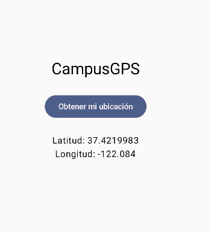
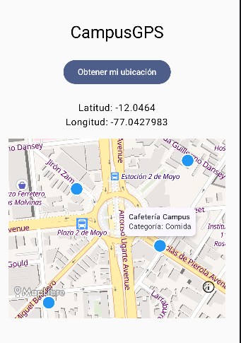
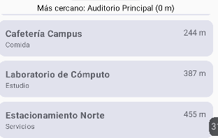
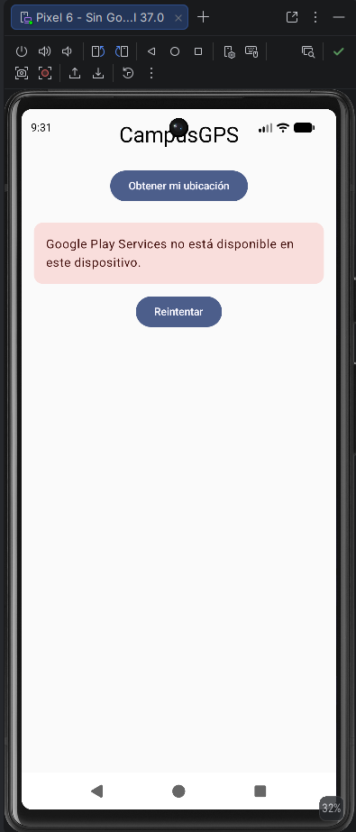
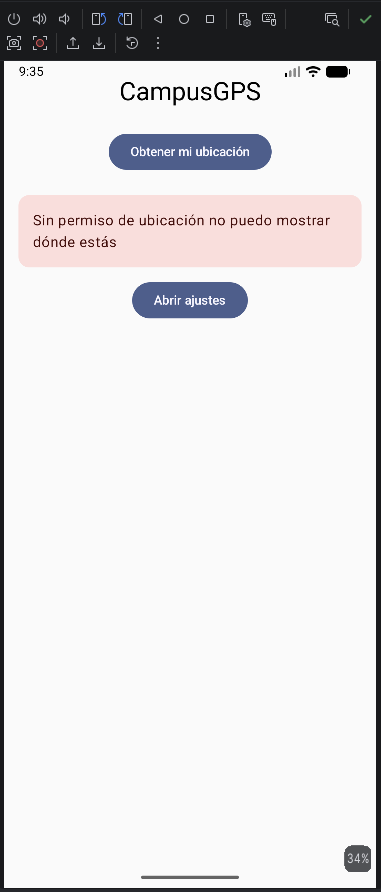
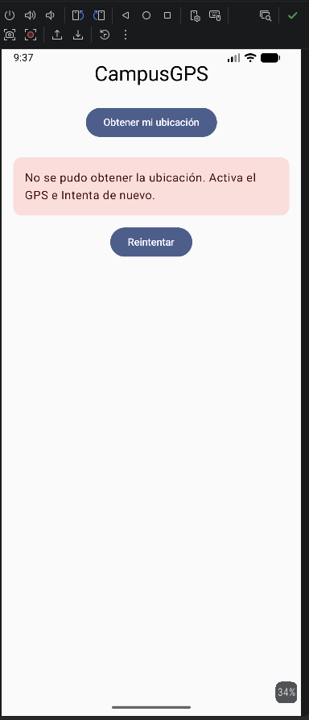

# CampusGPS

**Estudiante:** Michael Fernandez<br>
**Institución:** Tecsup<br>
**Programa:** Diseño y Desarrollo de Software<br>
**Curso:** Desarrollo de Aplicaciones Móviles<br>
**Laboratorio:** Semana 13<br>
**Lenguaje:** Kotlin<br>
**Entorno de desarrollo:** Android Studio

---

## 1. Descripción del proyecto

CampusGPS es una aplicación móvil desarrollada en Kotlin con Jetpack Compose que permite obtener la ubicación actual del usuario y visualizarla mediante un mapa interactivo.

La aplicación presenta cinco lugares ficticios de un campus ubicado en Lima, Perú. A partir de las coordenadas obtenidas del dispositivo, calcula las distancias hacia cada lugar y los ordena del más cercano al más lejano.

También permite seleccionar lugares, desplazar la cámara del mapa e identificar automáticamente el lugar más próximo.

El proyecto utiliza la arquitectura **MVVM (Model-View-ViewModel)** junto con el patrón **Repository**, permitiendo separar la interfaz, la lógica de presentación y el acceso a datos.

---

## 2. Objetivos

### Objetivo general

Desarrollar una aplicación Android que permita obtener la ubicación del usuario, representar lugares en un mapa y calcular distancias, utilizando Kotlin, Jetpack Compose y una arquitectura organizada.

### Objetivos específicos

- Implementar permisos de ubicación en tiempo de ejecución.
- Obtener coordenadas mediante FusedLocationProviderClient.
- Integrar un mapa interactivo.
- Representar cinco lugares ficticios mediante marcadores.
- Calcular distancias entre coordenadas.
- Ordenar los lugares según su cercanía.
- Implementar una lista de lugares seleccionables.
- Identificar automáticamente el lugar más cercano.
- Desplazar la cámara hacia un lugar seleccionado.
- Manejar errores relacionados con los permisos y servicios de ubicación.
- Aplicar la arquitectura MVVM + Repository.
- Utilizar Git y GitHub para registrar el desarrollo del proyecto.

---

## 3. Tecnologías utilizadas

| Tecnología | Función |
|---|---|
| Kotlin | Lenguaje de programación |
| Android Studio | Entorno de desarrollo |
| Jetpack Compose | Desarrollo de la interfaz |
| Material 3 | Componentes visuales |
| ViewModel | Gestión de estados y lógica de presentación |
| StateFlow | Actualización reactiva de la interfaz |
| Kotlin Coroutines | Ejecución de operaciones asíncronas |
| FusedLocationProviderClient | Obtención de ubicación |
| MapLibre Compose | Visualización de mapas interactivos |
| OpenFreeMap | Proveedor de mapas |
| MVVM | Arquitectura de presentación |
| Repository | Separación del acceso a datos |
| Git | Control de versiones |
| GitHub | Almacenamiento del repositorio |

### Uso de MapLibre y OpenFreeMap

La guía original del laboratorio utiliza Google Maps Compose.

En este proyecto se implementó **MapLibre Compose con OpenFreeMap** como alternativa para visualizar mapas sin configurar la facturación de Google Maps Platform.

La aplicación continúa utilizando Google Play Services para obtener la ubicación mediante FusedLocationProviderClient.

Por lo tanto, MapLibre se utiliza para visualizar el mapa y FusedLocationProviderClient para obtener las coordenadas del dispositivo.

Esta es una diferencia tecnológica respecto de la implementación propuesta en la guía.

---

## 4. Arquitectura del proyecto

CampusGPS utiliza la arquitectura **MVVM + Repository**.

Esta arquitectura permite organizar las responsabilidades y separar la interfaz de la lógica y del acceso a servicios.

### Diagrama de arquitectura

```text
                  USUARIO
                     |
                     v
                PantallaMapa
                     |
                     v
                MapaViewModel
                     |
              StateFlow / Estado
                     |
          -------------------------
          |                       |
          v                       v
 UbicacionRepository      LugaresRepository
          |                       |
          v                       v
 UbicacionRepository      LugaresRepository
       Google                   Local
          |                       |
          v                       v
 FusedLocationProvider      Cinco lugares
       Client                  ficticios
```

### Model

Contiene las clases que representan los datos utilizados por la aplicación.

Entre ellas:

- Posicion
- Lugar
- LugarConDistancia
- UbicacionUi
- TipoError

### View

Contiene las pantallas y componentes desarrollados con Jetpack Compose.

Su responsabilidad es representar los estados proporcionados por el ViewModel.

### ViewModel

Administra los estados de la aplicación y la lógica de presentación.

Sus responsabilidades incluyen:

- Solicitar la ubicación al Repository.
- Actualizar los lugares.
- Calcular y ordenar distancias.
- Administrar el lugar seleccionado.
- Identificar el lugar más cercano.
- Gestionar los estados de error.

### Repository

Define los contratos y las implementaciones utilizadas para obtener información.

En CampusGPS existen dos repositorios principales:

- UbicacionRepository
- LugaresRepository

Esta organización facilita el mantenimiento y permite separar las dependencias externas de la interfaz.

---

## 5. Estructura de paquetes

```text
CampusGPS/
|
|-- app/
|   |
|   |-- src/
|       |
|       |-- main/
|           |
|           |-- AndroidManifest.xml
|           |
|           |-- java/com/fernandez/campusgps/
|               |
|               |-- MainActivity.kt
|               |
|               |-- model/
|               |   |-- Modelos.kt
|               |
|               |-- data/
|               |   |-- LugaresRepository.kt
|               |   |-- LugaresRepositoryLocal.kt
|               |   |-- UbicacionRepository.kt
|               |   |-- UbicacionRepositoryGoogle.kt
|               |
|               |-- viewmodel/
|               |   |-- CampusViewModelFactory.kt
|               |   |-- MapaViewModel.kt
|               |
|               |-- ui/
|               |   |-- PantallaMapa.kt
|               |   |-- MapaUbicacion.kt
|               |   |-- ListaLugares.kt
|               |   |-- MensajeError.kt
|               |   |-- theme/
|               |
|               |-- util/
|                   |-- Distancia.kt
|                   |-- Formato.kt
|
|-- capturas/
|   |-- 01_inicio.png
|   |-- 02_mapa_ubicacion.png
|   |-- 03_lista_lugares.png
|   |-- 04_sin_play_services.png
|   |-- 05_permiso_denegado.png
|   |-- 06_gps_apagado.png
|
|-- gradle/
|-- build.gradle.kts
|-- settings.gradle.kts
|-- gradlew
|-- gradlew.bat
|-- README.md
```

---

## 6. Lugares del campus

La aplicación utiliza cinco lugares ficticios ubicados aproximadamente en Lima, Perú.

| ID | Lugar | Categoría | Latitud | Longitud |
|---|---|---|---|---|
| 1 | Biblioteca Central | Estudio | -12.0460 | -77.0435 |
| 2 | Cafetería Campus | Comida | -12.0470 | -77.0420 |
| 3 | Laboratorio de Cómputo | Estudio | -12.0455 | -77.0415 |
| 4 | Auditorio Principal | Eventos | -12.0480 | -77.0440 |
| 5 | Estacionamiento Norte | Servicios | -12.0440 | -77.0430 |

Los lugares están definidos en:

`data/LugaresRepositoryLocal.kt`

El punto base utilizado para las pruebas es:

```text
Latitud: -12.0464
Longitud: -77.0428
```

Estos datos son ficticios y se utilizan únicamente con fines académicos.

---

## 7. Funcionalidades implementadas

### 7.1. Solicitud de permisos

CampusGPS solicita al usuario autorización para acceder a la ubicación del dispositivo.

Se utilizan los permisos:

- ACCESS_FINE_LOCATION
- ACCESS_COARSE_LOCATION

La solicitud se realiza durante la ejecución de la aplicación.

### 7.2. Obtención de ubicación

Se utiliza FusedLocationProviderClient para obtener las coordenadas del dispositivo.

La ubicación se representa mediante:

- Latitud.
- Longitud.

### 7.3. Mapa interactivo

La aplicación integra MapLibre Compose con OpenFreeMap.

El mapa permite:

- Visualizar lugares.
- Desplazarse.
- Utilizar zoom.
- Seleccionar marcadores.
- Mover la cámara hacia una ubicación determinada.

### 7.4. Marcadores del campus

Se representan cinco lugares mediante marcadores.

Al seleccionar uno, se muestra:

- Nombre del lugar.
- Categoría.

Los marcadores normales se representan en azul.

### 7.5. Cálculo de distancias

La función `distanciaMetros()` utiliza el método de Android:

`Location.distanceBetween()`

Este método calcula la distancia aproximada entre dos coordenadas geográficas.

La función `formatearDistancia()` permite visualizar los resultados en:

- Metros.
- Kilómetros.

### 7.6. Lista ordenada

Los cinco lugares aparecen en una lista ordenada del más cercano al más lejano.

Cada tarjeta muestra:

- Nombre.
- Categoría.
- Distancia.

### 7.7. Selección de lugares

El usuario puede seleccionar un lugar desde la lista o desde el mapa.

Cuando se selecciona:

- Se actualiza el estado en el ViewModel.
- Se resalta la tarjeta seleccionada.
- La cámara se desplaza hacia el lugar.
- Se muestra su nombre y categoría en el mapa.

### 7.8. Lugar más cercano

CampusGPS identifica automáticamente el lugar más cercano según las coordenadas actuales.

El lugar más cercano se representa mediante un marcador verde.

También se muestra un botón:

**Ir al más cercano**

Este botón permite desplazar la cámara hacia dicho lugar.

### 7.9. Manejo de errores

La aplicación identifica y maneja los siguientes casos:

**Permiso denegado**

Muestra un mensaje y el botón «Abrir ajustes».

**GPS desactivado**

Muestra un mensaje indicando que debe activarse la ubicación y permite reintentar.

**Google Play Services no disponible**

Muestra un mensaje informativo y evita que la aplicación se cierre inesperadamente.

---

## 8. Pruebas realizadas

Durante el desarrollo se realizaron pruebas utilizando el emulador de Android Studio.

| Prueba | Resultado |
|---|---|
| Ejecución de CampusGPS | Correcto |
| Obtención de coordenadas | Correcto |
| Visualización del mapa | Correcto |
| Cinco lugares del campus | Correcto |
| Selección de marcadores | Correcto |
| Cálculo de distancias | Correcto |
| Ordenamiento de lugares | Correcto |
| Selección de tarjetas | Correcto |
| Identificación del lugar más cercano | Correcto |
| Marcador verde | Correcto |
| Permiso denegado | Correcto |
| GPS desactivado | Correcto |
| Google Play Services no disponible | Correcto |

---

## 9. Evidencias del funcionamiento

### 9.1. Pantalla inicial

La aplicación presenta el título CampusGPS y un botón para obtener la ubicación del dispositivo.



### 9.2. Mapa y ubicación actual

La aplicación obtiene las coordenadas y muestra el mapa interactivo.

También identifica el lugar más cercano y presenta la lista ordenada por distancia.



### 9.3. Lista de lugares

Los lugares se muestran mediante tarjetas con su nombre, categoría y distancia.



### 9.4. Google Play Services no disponible

Se utilizó un emulador Android Open Source sin Google Play Services.

La aplicación detectó la ausencia del servicio y mostró un mensaje informativo sin cerrarse.



### 9.5. Permiso de ubicación denegado

Se comprobó el comportamiento cuando el usuario rechaza el permiso.

CampusGPS muestra un mensaje y el botón «Abrir ajustes».



### 9.6. GPS desactivado

Se desactivaron los servicios de ubicación del emulador para comprobar el manejo del error.

CampusGPS mostró un mensaje y el botón «Reintentar».



---

## 10. Instrucciones de ejecución

### Requisitos

- Android Studio.
- Android SDK compatible.
- Emulador Android.
- Conexión a Internet para cargar el mapa.
- Google Play Services para obtener la ubicación mediante FusedLocationProviderClient.

### Pasos para ejecutar

1. Clonar el repositorio.
2. Abrir Android Studio.
3. Seleccionar la carpeta `Semana13/CampusGPS`.
4. Esperar la sincronización de Gradle.
5. Seleccionar un emulador Android.
6. Ejecutar la aplicación.
7. Conceder los permisos de ubicación.
8. Presionar «Obtener mi ubicación».

### Compilación desde PowerShell

```powershell
.\gradlew.bat :app:assembleDebug
```

Durante las pruebas del laboratorio se obtuvo:

```text
BUILD SUCCESSFUL
```

---

## 11. Preguntas de reflexión

### 1. ¿Por qué FusedLocationProviderClient está dentro del Repository y no del ViewModel?

Porque el Repository se encarga de acceder a los servicios externos, mientras que el ViewModel administra los estados y la lógica de presentación.

Esta separación permite mantener una arquitectura organizada y facilita las pruebas y el mantenimiento.

### 2. ¿Qué diferencia existe entre el permiso de ubicación y la clave de API de Maps?

El permiso de ubicación autoriza a una aplicación a acceder a las coordenadas del dispositivo.

La clave de API permite identificar y autorizar el consumo de determinados servicios externos.

Si falta el permiso, la aplicación no puede acceder a la ubicación del usuario.

Si falta una clave requerida por un proveedor de mapas, ese servicio puede rechazar las solicitudes.

En CampusGPS se utilizó MapLibre con OpenFreeMap, por lo que no se configuró una clave de Google Maps.

### 3. ¿Por qué la clave debe guardarse en local.properties y no directamente en el código?

Porque almacenar credenciales directamente en el código puede exponerlas cuando se publica un repositorio.

El archivo `local.properties` se mantiene fuera del control de versiones mediante `.gitignore`.

Si una clave se publica accidentalmente, se debe revocar, generar una nueva y revisar la exposición del repositorio.

### 4. ¿Dónde se calculan las distancias y por qué no en un Composable?

El cálculo se realiza mediante la función `distanciaMetros()` de la capa `util`.

El ViewModel utiliza esta función para actualizar y ordenar los lugares.

No se calcula dentro de los Composables porque la interfaz debe encargarse de mostrar información y no de ejecutar la lógica de cálculo.

Esto permite respetar la arquitectura MVVM.

### 5. ¿Qué sucede si el usuario niega dos veces el permiso de ubicación?

La aplicación debe continuar funcionando sin cerrarse.

Cuando Android deja de presentar automáticamente la solicitud de permisos, el usuario puede concederlos manualmente desde los ajustes.

CampusGPS muestra un mensaje explicativo y ofrece el botón «Abrir ajustes».

---

## 12. Conclusiones

1. Durante el desarrollo de CampusGPS aprendí a implementar la obtención de ubicación en Android utilizando Kotlin y FusedLocationProviderClient.

2. La arquitectura MVVM + Repository me permitió organizar mejor el código, separando las responsabilidades de la interfaz, el ViewModel y los repositorios.

3. La integración de MapLibre y OpenFreeMap permitió visualizar los lugares del campus mediante un mapa interactivo.

4. El cálculo de distancias permitió ordenar los lugares e identificar automáticamente cuál se encontraba más cerca del usuario.

5. Finalmente, comprendí la importancia de manejar correctamente los permisos y los errores de ubicación para evitar cierres inesperados y mejorar la experiencia del usuario.

---

## 13. Autor

**Michael Fernandez**  
Estudiante de Diseño y Desarrollo de Software  
Tecsup — 2026