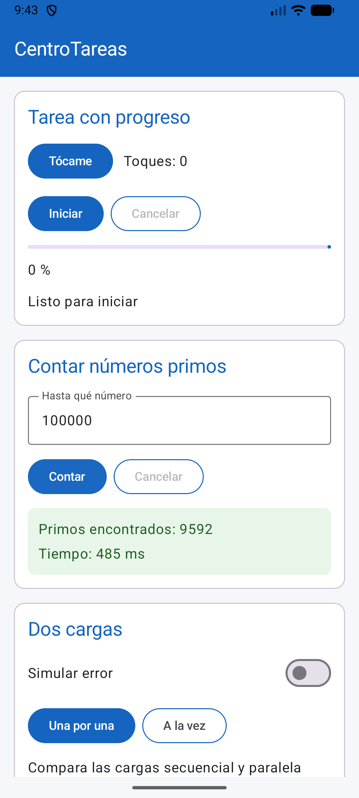
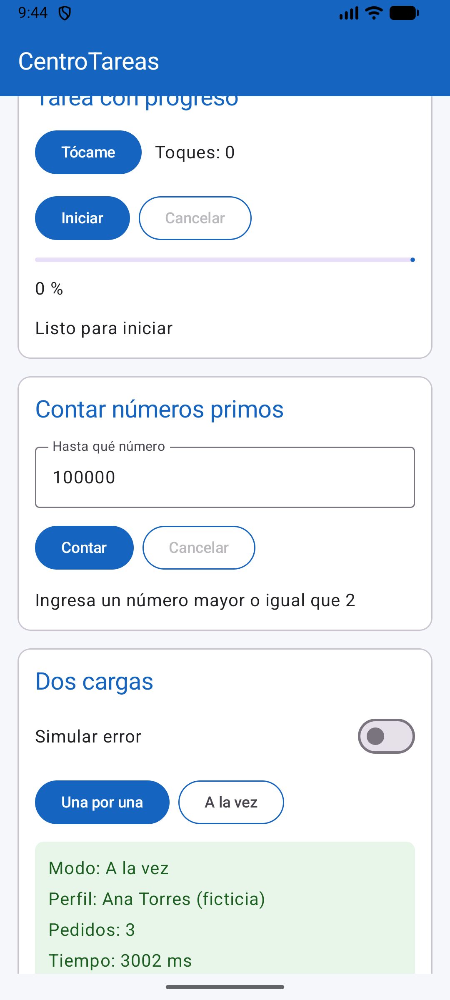
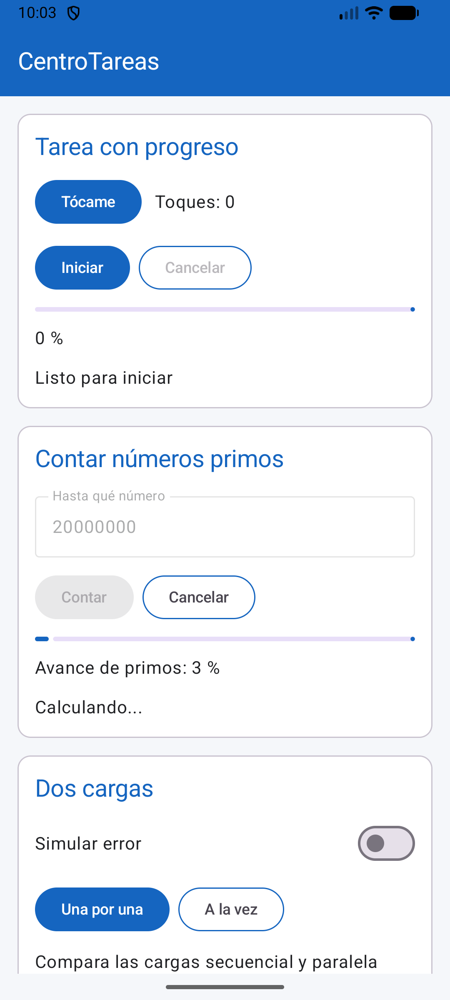
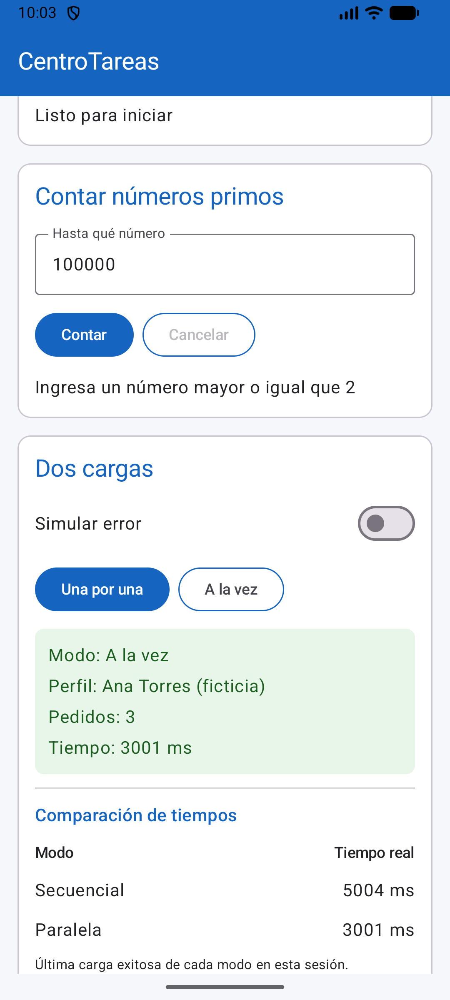

# Laboratorio 14 — CentroTareas: Hilos en Android

## 1. Descripción

Una única pantalla vertical desplazable demuestra cómo evitar bloqueos del hilo
principal, publicar progreso, cancelar trabajo y coordinar cargas con corrutinas.
Las tres tarjetas son **Tarea con progreso**, **Contar números primos** y
**Dos cargas**. No existe navegación adicional ni acceso real a Internet.

La Fase 1 (`main`) se implementó con **GPT-6.1 Sol mediante OpenCode**, siguiendo
la secuencia académica. No se presenta como trabajo sin IA. No se recibieron
imágenes de referencia adjuntas; se siguió la descripción visual proporcionada:
Material 3, cabecera y botones azules, tarjetas blancas, resultados verdes y
errores rojos. Las imágenes enlazadas abajo son capturas reales de la aplicación.

## 2. Tecnologías y compilación

- Kotlin, Jetpack Compose, Material 3, MVVM y Repository.
- Corrutinas, StateFlow, ViewModel y viewModelScope.
- Gradle Wrapper 9.4.1, Android Gradle Plugin 9.2.1.
- JDK 21 seleccionado por `gradle/gradle-daemon-jvm.properties`.
- compileSdk 36.1, targetSdk 36, minSdk 24.
- Compose BOM 2026.02.01 y Activity Compose 1.13.0 conservados de la plantilla.
- Dependencia solicitada: `lifecycle-viewmodel-compose:2.8.7`.
- Solo para pruebas JVM: `kotlinx-coroutines-test:1.9.0`, para ejecutar suspend
  con `runTest`, sin bloquear el hilo mediante `runBlocking`.

La plantilla inicial no compilaba: Core 1.19.1 y Lifecycle 2.11.0 requerían API
37. Se declararon Core 1.17.0 y Lifecycle Runtime 2.8.7 sin cambiar el SDK ni el
BOM. Gradle resuelve transitivamente Core 1.18.0 y Lifecycle 2.9.4, compatibles
con la configuración y verificados mediante compilación y dependencyInsight.

Desde esta carpeta, en Windows:

```powershell
.\gradlew.bat :app:assembleDebug
.\gradlew.bat :app:testDebugUnitTest
.\gradlew.bat :app:connectedDebugAndroidTest
.\gradlew.bat :app:lintDebug
```

`connectedDebugAndroidTest` requiere un dispositivo o emulador conectado por
ADB. Configurar localmente el SDK mediante Android Studio o `local.properties`;
este archivo, `.idea/`, `.gradle/` y `build/` están excluidos de Git.
APK debug: `app/build/outputs/apk/debug/app-debug.apk` (no versionado).

## 3. Estructura de paquetes

```text
app/src/main/java/com/tecsup/centrotareas/
├── MainActivity.kt
├── model/
│   └── Estados.kt
├── data/
│   ├── TareasRepository.kt
│   └── TareasRepositoryLocal.kt
├── viewmodel/
│   ├── TareasViewModel.kt
│   └── TareasViewModelFactory.kt
└── ui/
    ├── PantallaTareas.kt
    └── theme/
        ├── Color.kt
        ├── Theme.kt
        └── Type.kt
```

Las pruebas están en `app/src/test/` y `app/src/androidTest/`, también bajo
`com.tecsup.centrotareas`. Se aprovechó la estructura generada por Android
Studio, incluidos manifiesto, recursos y Wrapper; no se creó otro proyecto.

## 4. Arquitectura MVVM

```text
PantallaTareas ──eventos──> TareasViewModel ──suspend/Flow──> TareasRepository
      ↑                         │                           ↑
      └──── collectAsState() ───┘                 TareasRepositoryLocal
                StateFlow                          implementación
```

La pantalla solo recibe el ViewModel. La Activity construye la Factory que
inyecta el Repository. El ViewModel no recibe Context ni importa Compose.
Gestiona estados y trabajos, mientras el repositorio desconoce la interfaz
visual. No se realizan cálculos pesados en un composable.

## 5. Funcionamiento del Repository

`TareasRepository` define contar primos, cargar perfil y cargar pedidos; en
`con-ia` también expone los Flows de progreso de tarea y primos. Su
implementación local devuelve `Ana Torres (ficticia)` después de 2000 ms y
tres pedidos después de 3000 ms. Con error activado, pedidos lanza
`IOException("Sin conexión")`. Son simulaciones con `delay`, no llamadas de red;
no necesitan permisos, clientes HTTP ni servicios externos.

## 6. Corrutinas

Los eventos lanzan corrutinas en `viewModelScope`. En main el trabajo de CPU usa
`withContext(Dispatchers.Default)`; en con-ia el productor usa
`flowOn(Dispatchers.Default)`. `delay` suspende sin ocupar un hilo durante
la espera. Los logs de etiqueta `HILO` registran antes, dentro y después del
cambio de contexto en main. En con-ia se conservan Antes y Después en Main;
el bucle está en el repositorio y ya no existe el log Dentro del ViewModel.
Los tres trabajos son independientes: cancelar progreso
no cancela primos ni cargas.

## 7. StateFlow

Cada `MutableStateFlow` es privado y se expone como `StateFlow` mediante
`asStateFlow()`. Compose usa `collectAsState()` y envía eventos, sin modificar
el estado directamente. `PrimosUi` representa Inicial, Calculando, Listo y
Cancelado; `CargaUi`, Inicial, Cargando, Exito y Error. El contador de toques
también vive en el ViewModel y el campo numérico usa `rememberSaveable`.

## 8. Progreso

En `main`, el ViewModel ejecuta 100 iteraciones con `delay(40)` en Default.
El avance es `i / 100f`; se representa con LinearProgressIndicator y porcentaje.
Cada publicación del estado se despacha a Main para evitar reentradas de la
interfaz durante la rotación en el entorno instrumentado de Compose.
El contador Tócame sigue disponible mientras se ejecuta la tarea.

En **con-ia**, el repositorio implementa `progresoTarea(): Flow<Float>` con
`flow { emit(...) }` y `flowOn(Dispatchers.Default)`. Cada colección comienza
en 0 y emite los 100 avances. El ViewModel solo recoge el Flow en Main y
actualiza su StateFlow, sin contener el bucle ni sus esperas. La cancelación
del Job cancela también el productor y el nuevo inicio crea otra colección.

## 9. Cancelación

`trabajo: Job?` conserva la tarea. El inicio comprueba si ya hay un trabajo activo
y el botón Iniciar se deshabilita mientras corre. Cancelar solo se habilita
durante la ejecución. `cancel()` provoca una `CancellationException`, conserva
el porcentaje alcanzado y cambia el mensaje a Cancelado. La excepción se
relanza y `finally` restablece `corriendo = false`. Un nuevo inicio parte de 0.
Primos tiene su propio Job y su botón de cancelación.

## 10. Cálculo de primos

En ambas ramas el repositorio recorre `2..hasta` en `Dispatchers.Default` y ejecuta
`ensureActive()` en cada iteración. La función `esPrimo` comprueba divisores
hasta la raíz usando `d.toLong() * d <= n` para evitar desbordamiento.
El ViewModel mide con `System.currentTimeMillis()` y publica cantidad y tiempo.
La UI y el ViewModel ignoran límites menores que 2; la UI rechaza textos no
convertibles a Int, incluidos números fuera de rango.

En con-ia, `contarPrimosConProgreso` devuelve `Flow<AvancePrimos>`, con avance
y cantidad acumulada. `AvancePrimos` es un dato del cálculo, no un estado de
pantalla. Se emite como máximo una actualización por porcentaje entero, más
el 0 inicial, para no publicar un evento por número. El porcentaje usa Long
para el producto y el denominador. `contarPrimos(hasta)` sigue disponible y
reutiliza ese mismo algoritmo tomando la cantidad de la última emisión.
La UI muestra una segunda barra y porcentaje; conserva el avance al cancelar
y lo reinicia a cero al volver a contar. `ensureActive()` permanece en el ciclo.

Resultados comprobados por la prueba JVM que llama al repositorio real:

| Hasta | Cantidad |
| ---: | ---: |
| 100 | 25 |
| 1000 | 168 |
| 10000 | 1229 |
| 100000 | 9592 |
| 500000 | 41538 |

## 11. Cargas secuenciales

Una por una espera primero el perfil y luego los pedidos. La duración nominal
es 2000 + 3000 = 5000 ms. La última ejecución instrumentada para las capturas
midió **5003 ms**. La duración varía con el dispositivo y la carga del sistema.

## 12. Cargas paralelas

A la vez abre un `coroutineScope`, crea dos tareas `async` y obtiene sus
resultados con `await()`. La duración nominal es max(2000, 3000) = 3000 ms.
La misma ejecución midió **3002 ms**. Ambos botones se deshabilitan durante
la carga; se muestra un CircularProgressIndicator y, al terminar, un recuadro
verde con modo, perfil, cantidad de pedidos y duración medida.

## 13. Manejo de errores y reintentos

El Switch Simular error controla un StateFlow. Al comenzar cada carga se toma
una instantánea del valor y se envía a `repo.cargarPedidos`. El Switch se
deshabilita durante la carga. Las excepciones se convierten en
`CargaUi.Error("No se pudo cargar: " + mensaje)` y aparecen en un recuadro rojo.
`CancellationException` siempre se relanza y no se presenta como fallo de red.
Reintentar ejecuta `cargarALaVez()` con el valor actual del Switch: si sigue
activado vuelve a fallar; al desactivarlo termina correctamente.

## 14. Observación técnica del paso 1

El commit del paso 1 conserva `tareaLargaMala()`: asignaba Trabajando..., llamaba
`Thread.sleep(4000)` y asignaba Terminó. El evento del botón corre en el hilo
principal; al bloquearlo no puede procesar toques ni dibujar cuadros. Compose
no puede presentar Trabajando... antes del bloqueo, y al recuperar el hilo
el estado ya dice Terminó. Diez segundos de bloqueo podrían provocar un ANR,
dependiendo de los límites del sistema y los eventos pendientes.

Este comportamiento histórico se explica a partir del código; **no se ejecutó
manualmente aquella versión**. Desde el paso 2 se eliminó del código Kotlin.

## 15. Pruebas realizadas

### Fase 1 — main

Ejecutadas el **18 de noviembre de 2026** en Windows y en el emulador
**Medium_Phone, Android 17 / API 37**, conectado como `emulator-5554`.

| Verificación real | Resultado y alcance |
| --- | --- |
| Compilación debug | Correcta en cada paso antes de su commit |
| Pruebas JVM | 4 aprobadas: prueba aritmética de la plantilla y 3 de Repository |
| Valores de primos | Los cinco valores de la tabla, más límites 1, 2 y 3 |
| Cancelación CPU | Int.MAX_VALUE cancelado con cancelAndJoin y límite de 2 s |
| Pruebas instrumentadas | 6 aprobadas: paquete de la app y 5 pruebas de interfaz |
| Barra hasta 100 % | Se verificaron 1f, 100 % y Terminó |
| Cancelar y reiniciar | Cancelado, porcentaje conservado y reinicio desde cero |
| Doble inicio | Botón deshabilitado y segunda llamada al ViewModel durante la tarea |
| Tócame | Contador cambia durante progreso y durante primos grandes |
| Entrada y primos UI | Texto inválido, 1 y desbordamiento rechazados; 100000 → 9592 |
| Cancelar primos UI | Calculando → Cancelado usando su botón |
| Cargas | 5003 ms frente a 3002 ms; perfil y 3 pedidos comprobados |
| Error y reintento | Fallo secuencial, fallo paralelo y éxito al desactivar el Switch |
| Rotación | Paisaje y regreso a retrato; mismo ViewModel, entrada y contador conservados; tarea completa |
| Logcat HILO | Antes y Después en main; Dentro en DefaultDispatcher-worker |
| Lint debug | 0 errores y 19 advertencias, no ocultadas |
| Patrones prohibidos | Sin GlobalScope, runBlocking ni Thread.sleep en los archivos Kotlin finales |

Los tests de interfaz están en `PantallaTareasTest.kt`. Las capturas proceden
de `UiAutomation.takeScreenshot()` durante esos tests, no de imágenes generadas.
Se ejecutó la suite con Gradle y se repitió directamente con AndroidJUnitRunner
para recuperar las imágenes antes de desinstalar la aplicación. Las comprobaciones
de interfaz son **automatizadas**, no pruebas manuales realizadas por una persona.

Informes locales (ignorados por Git):
- `app/build/reports/tests/testDebugUnitTest/index.html`
- `app/build/reports/androidTests/connected/debug/index.html`
- `app/build/reports/lint-results-debug.html`

Advertencias Lint: API objetivo no más reciente, etiqueta redundante de la
plantilla, actualizaciones disponibles, colores XML heredados sin uso y
recomendación de mover las dos dependencias explícitas al catálogo. Se
mantuvieron las versiones compatibles y la estructura inicial, sin suprimir
los avisos ni actualizar dependencias por motivos ajenos al laboratorio.

**Incidencias y soluciones:**
1. Fallo AAR inicial por requerir API 37: ajuste de Core y Lifecycle.
2. Una ejecución de rotación falló con CalledFromWrongThreadException al
   publicar progreso desde Default en el entorno de pruebas Compose. Se
   trasladó exclusivamente la publicación a Main; después pasaron la suite
   completa y dos repeticiones directas. No se reescribieron commits previos.
3. Gradle desinstaló la app al finalizar las pruebas y eliminó las capturas
   externas: reinstalación de los APK ya compilados y ejecución directa del
   runner, seguida de `adb pull`.

**Pendiente de validación manual:** dispositivo físico, contraste/accesibilidad
con TalkBack y fuentes grandes, otros tamaños/API, y demostración histórica del
congelamiento. No se comprobó persistencia tras muerte del proceso (fuera del
alcance); ViewModel no equivale a almacenamiento persistente. Las imágenes de
referencia originales siguen sin estar disponibles para una comparación exacta.

### Fase 2 — con-ia

Ejecutada en el mismo entorno, después de cada mejora: compilación debug y
suite completa. Resultado final: **8 pruebas JVM y 7 instrumentadas aprobadas**.
Además de la regresión de las tres tarjetas, se verificaron:

- Flow de progreso: 101 emisiones ordenadas, límites 0 y 1 y nueva colección
  desde cero después de cancelar.
- Flow de primos: 101 emisiones para 500000, avance creciente, 41538 primos,
  cancelación, reinicio y conservación de los cinco resultados de la guía.
- Progreso de primos visible durante un cálculo de 20000000, cancelación por
  botón, porcentaje conservado y reinicio desde cero.
- Tabla inicialmente sin medidas, actualización independiente de cada modo,
  coincidencia con los tiempos de Exito y conservación de ambas medidas
  después de un error posterior.
- Rotación, contador Tócame, validación de entrada, progreso al 100 %, errores
  y reintentos también se ejecutaron en la versión mejorada.
- Última repetición directa del runner: **7 tests OK**; cargas reales de
  **5004 ms** y **3001 ms**, visibles en la captura de comparación.
- Lint final: **0 errores, 19 advertencias**, las mismas categorías ya descritas.

Una primera prueba de cancelación con 2000000 terminó el cálculo antes de
pulsar Cancelar tras tomar la captura y agotó la espera del test. Se aumentó
solo la entrada de prueba a 20000000 y se comprobó que el botón estuviera
habilitado antes de pulsarlo. Pasaron después la suite completa y la repetición
directa, sin introducir esperas artificiales en el algoritmo de producción.
Se mantienen las pruebas manuales pendientes indicadas arriba.

## 16. Capturas de evidencias

Capturas completas reales, sin edición, almacenadas en `capturas/main/`.
La comparación se registra en dos imágenes para mantener ambos tiempos legibles.

### 1. Tarea con progreso


### 2. Tarea cancelada


### 3. Conteo de primos


### 4. Comparación de cargas



### 5. Error simulado


## 17. Preguntas «Para pensar»

**1. ¿Por qué no se veía Trabajando...?**
Porque el hilo que debía dibujarlo estaba bloqueado. Cambiar el estado no
dibuja inmediatamente la pantalla: el hilo principal necesita ejecutar el
siguiente cuadro. Al liberarse, el estado ya había cambiado a Terminó.

**2. ¿Qué diferencia hay entre Thread.sleep y delay?**
Thread.sleep bloquea el hilo y no coopera con la cancelación de corrutinas.
delay suspende la corrutina, deja el hilo disponible y comprueba cancelación.
Una espera no equivale a un cálculo de CPU: para este se cambia de dispatcher.

**3. ¿Por qué Default para primos e IO para la red?**
Default tiene un conjunto de trabajadores adecuado a tareas intensivas de CPU.
IO está pensado para operaciones bloqueantes de entrada/salida. Un cliente de
red suspend y no bloqueante puede administrar su propio dispatcher. Aquí no
hay red real: las simulaciones usan delay, por lo que no necesitan IO.

**4. ¿Qué ocurre al cerrar una pantalla y qué hace viewModelScope?**
Las tareas se cancelan cuando se limpia el ViewModel, al finalizar su propietario.
Una rotación recrea la Activity pero conserva el ViewModel, por eso la tarea y
sus estados continúan. No toda salida momentánea de pantalla limpia su
ViewModel. viewModelScope evita mantener tareas huérfanas tras su destrucción;
delay y ensureActive permiten que las tareas cooperen con la cancelación.

**5. ¿Por qué async tarda 3 segundos y no 5? ¿Qué pasa si una carga falla?**
Ambas tareas empiezan sin esperar a la otra y se espera a la más lenta: unos
3 segundos. En coroutineScope el fallo de una hija cancela a las hermanas que
sigan activas y se propaga al padre; el catch publica Error. En esta simulación
perfil suele haber terminado cuando pedidos falla. No se entregan resultados
parciales ni se convierte una cancelación en éxito o error de conexión.

## 18. Historial y ramas

La Fase 1 sigue nueve commits reales y consecutivos, en este orden:

1. `chore: importa proyecto base CentroTareas`
2. `feat(hilos): provoca el congelamiento con Thread.sleep en el hilo principal`
3. `fix(hilos): mueve la tarea larga a una corrutina con withContext`
4. `feat(progreso): agrega barra de progreso con StateFlow`
5. `feat(cancelar): permite cancelar la tarea con Job`
6. `feat(primos): cuenta primos en Dispatchers.Default con cancelacion`
7. `feat(carga): compara carga secuencial y en paralelo con async`
8. `feat(errores): maneja errores de carga y agrega reintento`
9. `docs: agrega README con observaciones y capturas`

Ubicación: `Moviles_Fernandez/Semana14/CentroTareas`. Los commits del laboratorio
no incluyen archivos de otras semanas ni cambios en `Semana14/Lab14`.

### Integración de la rama con-ia existente

La rama con-ia ya existía en `52fbaa7`, con 20 commits exclusivos de laboratorios
anteriores. El usuario indicó conservarla, sin renombrar, eliminar, forzar ni
reescribir commits. La previsualización `git merge-tree` detectó 28 conflictos
add/add ajenos: 9 en CafeCampus, 12 en Catalogo y 7 en CampusGPS. Se detuvo la
integración y se solicitó autorización antes de tocar esos archivos.

Con la autorización explícita **«Autorizar merge selectivo»**, se realizó un
merge de dos padres usando la estrategia `ours` sin confirmar y se incorporó
exclusivamente CentroTareas desde main. Se verificó que todos los archivos
fuera del proyecto permanecieran exactamente como en `52fbaa7` y que el
proyecto importado coincidiera con main antes del commit de integración:

`28228eb merge: incorpora CentroTareas desde main conservando otros laboratorios`

Sus padres son la antigua con-ia (`52fbaa7`) y main (`29fc0f7`): los nueve commits
de CentroTareas son ancestros de con-ia, y main no se modificó después de su
publicación. A ese merge se agregan estos cuatro commits independientes:

1. `feat(ia): mueve el progreso al Repository usando Flow`
2. `feat(ia): agrega progreso al calculo de numeros primos`
3. `feat(ia): agrega comparacion de tiempos de carga`
4. `docs(ia): documenta prompts y mejoras realizadas`

En consecuencia, `git log main..con-ia --oneline` incluye también los 20 commits
históricos y el merge: no se oculta esa diferencia ni se afirma que muestre
solamente cuatro commits. Para inspeccionar **solo esta Fase 2**, usar desde
CentroTareas:

```powershell
git log 28228eb..con-ia --oneline
git diff main..con-ia -- .
git diff 52fbaa7..con-ia -- .
```

El diff global entre main y con-ia seguirá mostrando diferencias antiguas en
otros laboratorios. No son cambios realizados en esta sesión. La comparación
contra `52fbaa7` fuera de CentroTareas debe estar vacía.

## 19. Conclusiones

La capacidad de respuesta depende de no bloquear el hilo principal, no solo de
usar la palabra suspend. Repository aísla la simulación y el cálculo de CPU;
ViewModel administra el ciclo de vida, cancelación y estados observables. La
concurrencia estructurada reduce las cargas independientes de unos cinco a
tres segundos y propaga fallos de forma controlada. Compilar, medir y probar
rotación detectó problemas que una revisión estática no habría demostrado.

## 20. Comparación entre ramas y evidencias de las mejoras

| Aspecto | main: guía original | con-ia: tres mejoras |
| --- | --- | --- |
| Progreso de tarea | Bucle y delay en ViewModel | Flow frío en Repository, flowOn(Default) y collect en ViewModel |
| Primos | suspend devuelve cantidad; estados de cálculo | Flow de datos de avance, segunda barra y porcentaje; API suspend conservada |
| Tiempos de carga | Solo el resultado de la última operación | Última medida exitosa de cada modo en una tabla, sin valores prefijados |
| Arquitectura | MVVM + Repository + StateFlow | Misma separación; Repository produce datos, ViewModel mantiene estados UI |
| Documentación IA | Asistencia reconocida en README | README ampliado y [PROMPTS.md](PROMPTS.md) con interacciones reales |
| Verificación | 4 JVM y 6 instrumentadas | 8 JVM y 7 instrumentadas |

Las medidas están en StateFlow del ViewModel: sobreviven a rotación, no a la
muerte del proceso ni a una nueva sesión. «Sin medir» significa que ese modo
aún no terminó con éxito; un error no reemplaza ni inventa una medida.

Capturas reales adicionales de con-ia, sin editar:




Para demostrar las dos versiones en Android Studio, sin cambios pendientes:

```powershell
git checkout main
# Sincronizar Gradle y ejecutar: guía original.
git checkout con-ia
# Sincronizar Gradle y ejecutar: versión mejorada.
```

No se fusionó con-ia hacia main. Ambas contienen el proyecto completo y no
dependen de archivos exclusivos de la otra rama. El merge selectivo autorizado
solo integra main hacia con-ia y conserva el resto de su árbol histórico.
